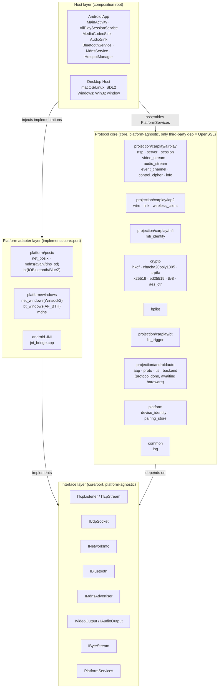
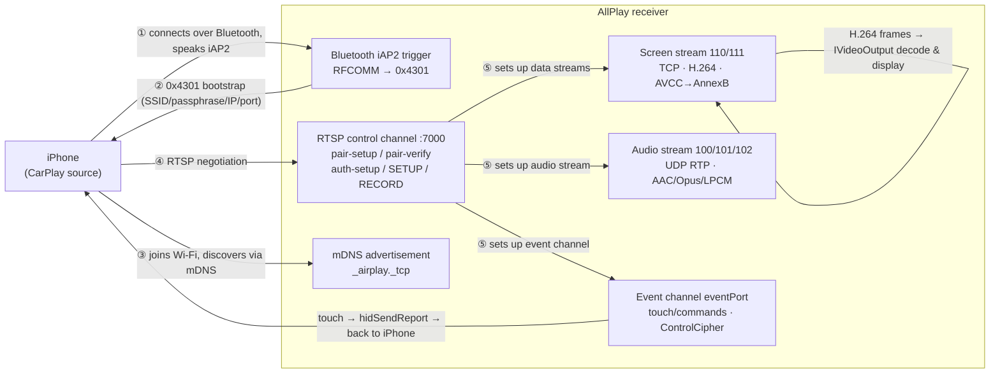

# AllPlay

<div align="left"><b>English</b> · <a href="README.zh-CN.md">简体中文</a></div>

**A CarPlay receiver (wireless + wired), cross-platform.** One platform-agnostic C++
implementation of the protocol that puts an iPhone's CarPlay on any screen — video on
display, audio playing, touch sent back.

**The protocol core is written once.** Each platform only implements its own "screen /
speaker / Bluetooth / network"; they are peers — no primary platform, and no shared
platform code.

**The protocol core is growing into a multi-protocol backend.** Since v1.1,
`core/projection/` uses `IProjectionBackend` to plug in different screen-mirroring
protocols: CarPlay is the first backend, wired Android Auto has its protocol and USB
transport layer in place (awaiting hardware), and CarLife / HiCar have their interfaces
reserved. See [`docs/projection-backend.md`](docs/projection-backend.md).

`GPL-3.0` · `Android ✅` · `HarmonyOS ✅` · `Linux ✅` · `macOS ✅` · `Windows ⏳`


---

## What is this

CarPlay is supposed to be a private link between an iPhone and a car head unit. AllPlay
implements **the head-unit side**, both ways:

**Wireless** (Bluetooth wakes the phone → mirroring over Wi-Fi)

| Step | What happens |
|---|---|
| ① Bluetooth trigger | Connect to the iPhone, "wake it up" over iAP2, and tell it the Wi-Fi SSID / passphrase / our IP and port |
| ② Discovery | The iPhone joins the same LAN and finds us over mDNS (`_airplay._tcp`) |
| ③ Negotiation | The RTSP control channel performs pairing and stream negotiation: video / audio / event channel |
| ④ Mirroring | H.264 screen stream decoded and displayed, audio stream decoded and played, touch sent back over the event channel |

**Wired** (just plug in a cable — no Bluetooth, no shared subnet needed)

| Step | What happens |
|---|---|
| ① Identify the device | Switch the iPhone out of its normal USB configuration into the **CarPlay configuration**, opening its USBMUX interface |
| ② Control plane | usbmux v2 → lockdown pairing → upgrade in place to TLS → start `com.apple.carkit.service` |
| ③ Negotiate the link | iAP2 over that service stream: **the host sends the marker + SYN first** (waiting for the phone to speak first gets you silence) → identify → MFi → power and subscriptions |
| ④ Hand over the address | On the phone's `0x4300`, reply `0x4301` with our **IPv6 link-local address pinned to the USB NIC** and port |
| ⑤ Mirroring | The phone connects to that address; from here it **shares the entire** RTSP / encryption / screen-stream code with the wireless path |

> **⚠️ The last gate on both paths needs an Apple MFi accessory identity** (`identity/`).
> That is a credential signed by Apple, **not part of this repository** — bring your own.
> Details under [Current status](#current-status).

**Android Auto (wired, in progress)**: `core/projection/androidauto/` already implements
AOAP (51/52/53) → AAP VERSION → TLS 1.2 → service discovery → channels / audio-video /
touch, with `platform/posix/aa_usb_libusb.cpp` providing the libusb transport shared by
Linux and macOS. **Not yet wired into the host UI, not yet validated on hardware.**

**CarLife / HiCar**: `core/projection/{carlife,hicar}/` are placeholder backends — full
interface, `probe()` returns empty, `connect()` reports not-implemented.

## Platform support

| Platform | Video | Audio | Wireless trigger | Wired (USB) | Status |
|---|---|---|---|---|---|
| **Android** | MediaCodec hardware decode → Surface | AudioTrack | `BluetoothSocket` (JNI) | — | ✅ End to end |
| **HarmonyOS** | AVCodec NDK hardware decode → XComponent surface | OH AudioCodec decode → OHAudio render (AAC-LC) | ArkTS `socket.sppConnect` | — | ✅ **On-device end to end** (Bluetooth trigger → fullscreen mirroring → touch → audio, Mate 60) |
| **Linux / Ubuntu** | ffmpeg software decode → SDL2 texture | SDL2 (AAC-LC / Opus / LPCM) | BlueZ: SDP + raw RFCOMM (client mode) | libusb + kernel `cdc_ncm` | ✅ **Both paths end to end with a real iPhone** |
| **macOS** | Same as Linux (**shared host code**) | Same as Linux | IOBluetooth | System `usbmuxd` + `AppleUSBNCMData` (never touches USB, no DriverKit) | ✅ **Wireless and wired both end to end on a real iPhone** (wired: iPhone plugged straight into the Mac, video + sound; wireless: Bluetooth trigger → mirroring → touch, auto-reconnect on drop) |
| **Windows** | ffmpeg (to be wired up) | — | `AF_BTH` (to be wired up) | — | ⏳ Skeleton |

The wired **media plane is not ours to write**: on Linux, once the CarPlay configuration is
entered, the kernel's `cdc_ncm` brings up a real network interface by itself; on macOS the
system already hangs the NCM function off `AppleUSBNCMData` as `enX`. Both paths only need
AirPlay bound to that interface — NTB16 / Ethernet / IPv6 are none of our business.

The macOS control plane doesn't touch USB either: it borrows the system `usbmuxd`
(`/var/run/usbmuxd`, the very tunnel Finder uses) to reach lockdown and the carkit service.
The prerequisite is that this Mac has already been trusted by the phone in Finder.

**Android Auto (wired)** currently has a transport implementation only on the Linux / macOS
desktop side (libusb, `platform/posix/aa_usb_libusb.cpp`); the protocol layer itself is
platform-agnostic, and the Android / HarmonyOS hosts still lack their own USB transport and
UI entry point (see [Current status](#current-status)).

- **No primary platform.** Each one only implements the `core/port` interfaces and shares no
  platform code with the others; the two desktop platforms share `host/` only because they
  happen to both use SDL2.
- **One acceptance method for all.** On every platform, `tools/fake_phone` can play the
  iPhone and run the whole chain — no real device, no second machine.

## Architecture

Four layers, **dependencies point inward only**:

```
host/          Host layer (composition root) — assembles the three below, owns window/main loop/input
platform/      Adapter layer — implements core/port with system APIs (POSIX / BlueZ / IOBluetooth / Win32 / JNI)
core/port/     Interface layer — pure abstraction, no implementation (ITcpStream / IBluetooth / IVideoOutput / MediaKeyQueue …)
core/projection/ Protocol backend layer — IProjectionBackend / IProjectionSession / IProjectionSink;
               CarPlay under carplay/ (formerly airplay / iap2 / mfi / usb / bt),
               Android Auto under androidauto/, CarLife / HiCar as placeholders
core/          Protocol core — pure C++, no platform headers, only third-party dependency is OpenSSL
```

**Only `core/` is "the project itself"**: RTSP, iAP2, crypto primitives, screen stream,
event channel all live here, and it compiles and self-tests on its own without any platform.
Platform differences are injected exclusively through `core/port/*.h`.

Input in the other direction (**steering-wheel / media keys**) follows the same layering:
`core/port/control.h` defines only "which key was pressed" and a thread-safe
`MediaKeyQueue`; the upper layer pushes physical keys into the queue and the `iap2` side
(wireless `WirelessTrigger`, wired `WiredLink`) encodes them into HID reports back to the
phone. **Where the keys come from (UI, system media keys, hardware GPIO) is up to each
platform**, and `core` never touches it.

<details>
<summary>Layered architecture diagram (click to expand)</summary>



</details>

<details>
<summary>Wireless CarPlay data flow (click to expand)</summary>



</details>

Per-module responsibilities and the platform adapter matrix are in
[`docs/architecture.md`](docs/architecture.md); protocol details (message formats,
handshake flow) are collected in [`docs/PROTOCOL-NOTES.md`](docs/PROTOCOL-NOTES.md).

## Quick start

### Desktop (Linux / Ubuntu or macOS)

```bash
bash scripts/bootstrap.sh      # dependencies: SDL2 / SDL2_ttf / ffmpeg / avahi
                               # (Linux: plus bluez + dbus-1 + libusb-1.0;
                               #  macOS: `brew install libusb` for wired Android Auto)
bash scripts/build.sh          # artifacts land in build/
./build/m3_test                # self-test: all green means the protocol core is fine
./build/aa_wire_test           # Android Auto wire-layer self-test (AAP framing + protobuf, no phone needed)
```

> **The `scripts/*.sh` files have no execute bit in the repo**, so run them as
> `bash scripts/xxx.sh`; `./scripts/build.sh` fails with permission denied.

Starting the host. Three ways:

```bash
# ① Wait for a phone to connect (classic receiver)
./build/allplay_host --name "AllPlay"

# ② Go wake the phone up (Bluetooth iAP2 trigger → then catch the mirroring it sends over)
./build/allplay_host --statusbar \
  --bt --bt-device iPhone --ssid "<your Wi-Fi SSID>" --wifi-pass "<passphrase>"

# ③ Wired (cable plugged in, no Bluetooth, no shared subnet) — see prerequisites below
./build/allplay_host --wired --identity identity
```

- The `--bt` / `--wired` switches are **strictly opt-in**; without them the behaviour is
  exactly that of a plain receiver, and the two are mutually exclusive.
- `--bt-addr AA:BB:CC:DD:EE:FF` connects by Bluetooth address, which is more reliable than
  matching by name.
- A failed trigger retries the whole chain every 3 seconds (`--bt-retry`, 10 attempts by
  default); press `B` at runtime to trigger again. If wired setup fails, press `W` to start
  over (no need to restart the program after unlocking the phone and dismissing the "Trust"
  dialog).
- **If another CarPlay receiver is on the same subnet** (a factory head unit with its own
  MFi, say), the iPhone may auto-reconnect to it — power that unit down while testing this one.

#### Wired prerequisites (Linux, **all three required**)

```bash
# ① We need exclusive access to the USBMUX interface; the system usbmuxd must step aside
sudo systemctl stop usbmuxd && sudo systemctl mask usbmuxd
# ② Otherwise gvfs races us to mount the iPhone's photos
pkill -f gvfsd-gphoto2
# ③ Block the kernel's apple_mfi_fastcharge — it claims the device
echo "blacklist apple_mfi_fastcharge" | sudo tee /etc/modprobe.d/blacklist-apple-mfi.conf
```

**The whole program must run as `sudo`** (`/dev/bus/usb/*` is root-only). Note that `sudo`
resets the environment:

```bash
sudo env ALLPLAY_LOG=info ALLPLAY_STATE_DIR="$HOME/.local/state/allplay" \
  ./build/allplay_host --wired --identity identity
```

`ALLPLAY_STATE_DIR` must be given explicitly — otherwise `HOME` becomes `/root`, the local
identity starts from scratch, and the phone has to be paired again every time.

Two things that look like faults but aren't: **a locked phone reports only one USB
configuration** (iOS behaviour, not a cable problem — just unlock it); and **on first
connection the phone shows a "Trust This Computer" prompt**, and if nobody taps it, it
resets the whole USB link after about 40 seconds — the log shows the device disappearing,
not a timeout.

Once running, it looks like this (real iPhone, cable plugged in, host in `--wired` mode):


**Touch works too**, and it travels the **exact same** event channel as the wireless path
(`POST /command` + encrypted HID) with not a single line changed — this shot is one click
injected onto the "Appearance" row, and the phone followed us into that page:


> Audio was not verified over wired: in that session the phone never created an audio
> stream (CarPlay only creates one when sound is actually playing). The code path is shared
> with wireless, but **anything not exercised on real hardware doesn't count**.

### End-to-end acceptance (**no iPhone needed**)

`tools/fake_phone` plays the iPhone and runs the entire RTSP and screen-stream path with
real sockets and real encryption:

```bash
# First, produce a test stream
ffmpeg -f lavfi -i testsrc2=size=1280x720:rate=60 -t 10 -c:v libx264 \
  -preset veryfast -pix_fmt yuv420p -g 60 -bf 0 -bsf:v h264_mp4toannexb -f h264 out.h264

# Terminal 1: the host (--port 7100 avoids the pitfall below)
SDL_VIDEODRIVER=dummy SDL_AUDIODRIVER=dummy ./build/allplay_host \
  --no-avahi --port 7100 --dump /tmp/x.ppm

# Terminal 2: the fake iPhone
./build/fake_phone --h264 out.h264 --port 7100 --fps 60
```

**Four numbers to check**: the touch coordinates printed by `fake_phone` match the injected
values; the audio frames pushed match the host's decoded frames; the `--dump`ed PPM converted
to PNG is colour bars and **red really is red** (red/blue swapped means the YUV plane order is
wrong); and `m3_test` is still all green.

### Android

```bash
cd android && ./gradlew :app:assembleDebug      # needs Android SDK + NDK + OpenSSL cross-compiled for arm64-v8a/armeabi-v7a
```

`minSdk 19` (Android 4.4+), `targetSdk 34`, ABIs `arm64-v8a` + `armeabi-v7a` (the latter for
32-bit boxes). The NDK must be **r25c** (r26 dropped API 19 support); OpenSSL goes in
per-ABI directories (`openssl-arm64` / `openssl-arm`). Cross-compilation notes are at the top
of `android/app/src/main/cpp/CMakeLists.txt`.

### HarmonyOS

```bash
scripts/build-ohos-openssl.sh                   # ① cross-compile OpenSSL (output in tmp/ohos-ssl/, not committed)
scripts/sync-harmony-identity.sh                # ② copy identity/ into the HAP's rawfile (already gitignored)
cd harmony && hvigorw assembleHap --mode module -p product=default
hdc install -r entry/build/default/outputs/default/entry-default-signed.hap
```

- Requires **DevEco Studio** (HarmonyOS SDK + NDK); `harmony/build-profile.example.json5` is
  the signing-config template — copy it to `harmony/build-profile.json5`, fill in your own
  certificate; the real config is not committed.
- The protocol all lives in `core/`, compiled into `liballplay_core.so` through NAPI;
  Bluetooth SPP, mDNS advertisement and screen size go through ArkTS system APIs.
- **Video**: `OH_VideoDecoder_CreateByMime` hardware decode (NDK AVCodec), rendering straight
  to the `XComponent` surface via `RenderOutputBuffer`. avcC is converted to AnnexB, with the
  SPS/PPS re-sent in-band before every IDR (the `OH_MD_KEY_CODEC_CONFIG` route never reached
  the decoder on real hardware).
- **Fullscreen**: the display resolution is negotiated from the screen aspect ratio (e.g.
  1920×868) and the iPhone reflows the CarPlay UI for that size; after rotating to landscape it
  fills 1:1. The launcher stays portrait.
- **Touch**: XComponent `onTouch` → normalized coordinates → `core`'s event channel → HID
  `touchReport` (two contacts).
- **Audio** (`harmony_audio.cpp`): `OH_AudioCodec` in sync mode → `OHAudio` renderer. The phone
  sends **raw AAC frames** (type=102, `0x800000`, 48 kHz stereo); we prepend a 7-byte ADTS
  header to each and set `OH_MD_KEY_AAC_IS_ADTS` to 1 — the out-of-band ASC route decodes
  nothing on this device's decoder. On the playback side a 1.5 s ring buffer with a 700 ms
  resume watermark absorbs Wi-Fi jitter and the phone's bursty delivery. While streaming, the
  on-screen "Cancel" button is covered by the video.

## Current status

| Milestone | Scope | Status |
|---|---|---|
| M0 | Skeleton: CMake + SDL window/status bar + scripts | ✅ |
| M1 | core: RTSP + `/info` (bplist) + mDNS advertisement `_airplay._tcp` | ✅ |
| M2 | Bluetooth trigger: iAP2 stack (identify / MFi / subscriptions / 0x5703 / 0x4301) | ✅ Software complete; **Linux BlueZ reaches a real iPhone all the way to `0x4301 CarPlayStartSession`** |
| M3 | Session + video: pair-setup/verify, auth-setup, SETUP, ControlCipher, screen stream | ✅ Android end to end (including an Android 4.4 box); ✅ desktop ffmpeg decode & display; ✅ **real iPhone running on an Ubuntu desktop (2026-10-12)** |
| M4 | Wired (USB) CarPlay: libusb config switch + usbmux/lockdown/TLS + kernel `cdc_ncm` media plane | ✅ **Real iPhone wired end to end (2026-10-13), host `--wired`** |
| M5 | Status bar info + robustness (reconnect / keyframe recovery / watchdog) | Partial (keyframe recovery wired up) |
| M6 | UI status page / overlay (native) | |
| M7 | Protocol backend-ization: `IProjectionBackend` + registry + CarPlay module (v1.1) | ✅ Builds and passes regression; the host is not switched to the registry yet |
| M8 | Wired Android Auto: AOAP → AAP → TLS 1.2 → audio-video/input (v1.1) | 🟡 Protocol + libusb transport done, **awaiting hardware**; host UI not wired up |

> **Both paths work.** Wireless: 2026-10-12, Bluetooth trigger → mDNS discovery → RTSP
> negotiation → screen stream on display → touch responds (see [`CHANGELOG.md`](CHANGELOG.md)
> v0.3). Wired: 2026-10-13, plug in and it works, with the control plane written by us and the
> media plane left to the kernel, 200 seconds of continuous streaming without a drop (see v0.4).
> What remains is blocked on the **credential**: iAP2's `0xAA00 request certificate` requires an
> accessory identity issued under the Apple MFi program (`identity/`). A self-supplied identity
> is enough to walk the whole chain during development, but **a pure-software identity is not a
> shipping path**.

Version history is in [`CHANGELOG.md`](CHANGELOG.md).

### Self-tests

| Command | Coverage | Needs hardware |
|---|---|---|
| `./build/core_selftest` | M1: RTSP + `/info` + mDNS advertisement | No |
| `./build/iap2_test identity` | M2: iAP2 wire format + link layer + **MFi signing** | No, but **requires `identity/`** |
| `./build/m3_test` | M3: SRP reference vectors + full fake-phone flow + screen stream | No |
| `./build/aa_wire_test` | Android Auto wire: AAP framing/deframing + protobuf subset | No |
| `./build/video_probe --h264 x.h264` | Decode + letterbox display smoke test | No |
| `./build/wired_probe --selftest` | Wired: lockdown plist / certificates / TLS loopback (**no phone, no sudo**) | No |
| `./build/allplay_host` + `./build/fake_phone` | End to end | No |
| `./build/wired_probe --link --mfi-dir identity` | Wired control plane (needs a real iPhone + sudo + the three prerequisites above) | Yes |

Run any of them with `--help` for the full set of options.

## Repository layout

```
core/          Protocol core (platform-agnostic; only third-party dep OpenSSL; no platform headers)
  projection/    Protocol backends (backend.h / registry + carplay / androidauto / carlife / hicar);
                 CarPlay's airplay·iap2·mfi·usb·bt now live under projection/carplay/
  port/          Abstract interfaces: IByteStream / ITcpListener·ITcpStream / IBluetooth /
                 IMdnsAdvertiser / INetworkInfo / IVideoOutput + PlatformServices composition root
  crypto/ bplist/ Shared protocol infrastructure (crypto primitives / binary plist)
platform/
  posix/         Linux + macOS adapters (socket / avahi·dns_sd / bluez·IOBluetooth /
                 libusb (wired CarPlay + Android Auto) ·usbmuxd+AppleUSBNCMData)
  windows/       Winsock2 / AF_BTH
android/         Android project (Gradle: Kotlin + NDK C++ core + JNI → system APIs)
harmony/         HarmonyOS project (ArkTS + hvigor: core through NAPI into the HAP, AVCodec → XComponent)
host/            Desktop host (SDL2 / ffmpeg)
  bt_task          Wireless trigger task (--bt: actively wake the phone)
  wired_task       Wired attach task (--wired: two-stage USB control plane, see top of that file)
  media/           ffmpeg software decode + SDL video/audio sinks
tools/           Self-test and acceptance tools (core_selftest / iap2_test / m3_test / aa_wire_test /
                 fake_phone / video_probe / usb_probe / wired_probe)
docs/            Architecture notes · protocol notes · screenshots (images/)
scripts/         bootstrap / build / deploy / check scripts
```

**`identity/` is not in the repository** (see `.gitignore`). It is the Apple-signed MFi
accessory credential and is sensitive: don't copy it elsewhere, don't put it in any repository;
`scripts/deploy.sh` does carry it when syncing to a target machine (needed to run there), but
remember `--exclude 'identity'` when syncing anything else.

## Dependencies

The principle is **system libraries only** — no third-party code you have to build yourself.

| Component | Dependencies | License |
|---|---|---|
| `core/` | OpenSSL (only third-party dependency) | Apache-2.0 |
| Desktop host | SDL2 + SDL2_ttf, ffmpeg (libavcodec / libavutil / libswscale) | zlib / LGPL-2.1+ |
| Linux adapters | avahi-client, bluez (libbluetooth), dbus-1, libusb-1.0 (wired CarPlay / Android Auto; skipped if absent) | LGPL-2.1+ |
| macOS adapters | IOBluetooth / CoreWLAN / dns_sd (system frameworks) | System |
| macOS adapters | libusb-1.0 (wired Android Auto; skipped if absent) | LGPL-2.1+ |
| Android | SDK / NDK (BluetoothSocket, MediaCodec, AudioTrack, NsdManager) | System |

Two deliberate omissions: `libswresample` (see the note at the top of
`host/media/ffmpeg_compat.h`) and `fdk-aac` (audio always goes through ffmpeg's built-in
decoders). `libavformat` isn't needed here.

## License and acknowledgements

Released under **GPL-3.0**. This is a **C++ reimplementation** of the CarPlay receivers
**DiPlay** / **xcertplay** (also GPL-3.0). Since v1.1 it has grown into a multi-protocol
backend architecture; the Android Auto protocol facts reference **AASDK / OpenAuto**
(GPL-3.0) and were written independently, without copying their source. The full license text
is in [`LICENSE`](LICENSE); upstream attribution and third-party licenses are in
[`THIRD_PARTY_NOTICES.md`](THIRD_PARTY_NOTICES.md).

## Troubleshooting

- **The window won't open / fonts are missing** (desktop): `bash scripts/bootstrap.sh`
  installs `fonts-dejavu-core`.
- **The host builds fine but shows a black screen**: bisect with
  `./build/video_probe --h264 x.h264` first — a picture means the protocol side, no picture
  means the decode side.
- **`:7000` won't bind**: macOS's `ControlCenter` (the AirPlay receiver) holds port 7000
  permanently; the host silently falls back to 7001 while `fake_phone` defaults to 7000 →
  **give both an explicit `--port 7100`**.
- **The phone never connects at all** (not a single RTSP line in the log — note this is
  different from "connects then drops"): first check whether the mDNS TXT records are real
  key/value pairs — `avahi-browse -t -r -p _airplay._tcp | grep -i allplay` should show
  `deviceid=` / `features=` / `flags=0x4` / `srcvers=` / `pi=`. The iPhone identifies receivers
  by these fields and won't connect without them. For comparison: a Mac on the same subnet
  advertises `flags=0x204`; a CarPlay receiver advertises `flags=0x4`.
- **Watch the status bar**: run the host with `--statusbar`; the dot at the bottom left is the
  state (grey = idle, yellow = waiting for pairing, green = video streaming, red = error) and
  the right side shows resolution / fps / frames / audio underruns. **fps dropping to 0 on a
  static page is normal** — the AirPlay screen stream only sends frames when the picture
  changes; it is not a hang.
