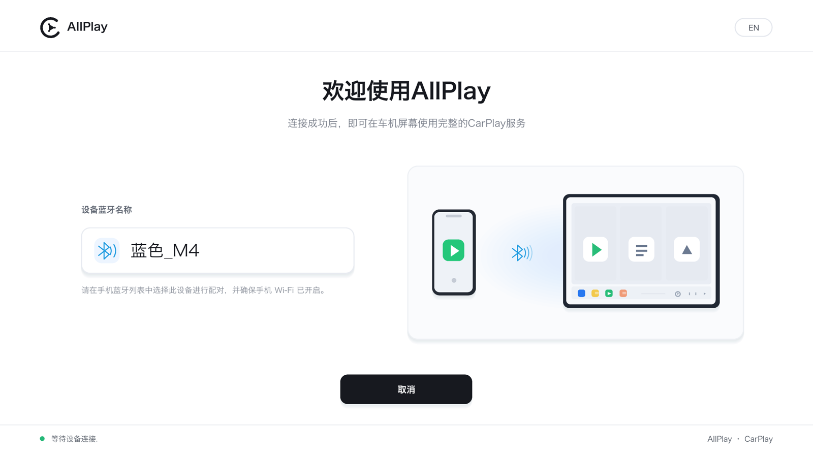

# AllPlay

<div align="left"><b>English</b> · <a href="README.zh-CN.md">简体中文</a></div>


**AllPlay is a head-unit-side CarPlay receiver written in C++17.** It implements the real
protocol stack end to end — AirPlay RTSP, iAP2, MFi-SAP, USB lockdown/TLS, and AAP —
decodes H.264 video and AAC-LC/Opus/LPCM audio locally, and sends touch back as HID
reports. Wireless and wired CarPlay share the same AirPlay session core; only the
bootstrap and transport layers differ.

Engineering scale (v1.1, headers included):

- `core/` — ≈13.7k lines of C/C++, zero platform headers, one third-party dependency
  (OpenSSL).
- Desktop composition root + platform adapters + acceptance tools — ≈27.6k lines.
- Android host — ≈2.5k lines of Kotlin/C++.
- 5 platform targets; 4 protocol backends (1 shipping, 1 protocol-complete, 2 interfaces only).



---

## 1. Scope

### Implemented and exercised on hardware

| Path | What runs |
|---|---|
| **Wireless CarPlay** | Bluetooth iAP2 trigger → mDNS discovery → RTSP negotiation → encrypted H.264/AAC streams → touch and media keys |
| **Wired CarPlay** | USB configuration switch → usbmux v2 → lockdown → in-place TLS → `com.apple.carkit.service` → iAP2 → kernel NCM media plane |
| **Media pipeline** | H.264 hardware decode on Android/HarmonyOS, ffmpeg software decode on desktop; AudioTrack / OHAudio / SDL2 output |
| **Protocol backend façade** | `IProjectionBackend` / `IProjectionSession` / `IProjectionSink`; CarPlay is the first backend |

### Implemented but not hardware-validated

- **Wired Android Auto**: AOAP 51/52/53 → AAP VERSION → TLS 1.2 → service discovery →
  control/video/audio/input channels. Protocol and libusb transport compile and pass
  `aa_wire_test`; **no real phone run, no host UI entry point**.

### Interfaces only / not implemented

- **CarLife**, **HiCar**: `probe()` returns empty, `connect()` reports not implemented.
- **Windows host**: Winsock2 networking compiles; mDNS, Bluetooth, ffmpeg video and audio
  output are TODO.
- **Wired CarPlay or Android Auto on Android/HarmonyOS hosts**: no USB transport or UI.

### Not claimed

AllPlay is not an Apple product and is not MFi-authorized. It contains no Apple code,
binaries, or documentation. Protocol facts come from public upstream implementations; see
[`THIRD_PARTY_NOTICES.md`](THIRD_PARTY_NOTICES.md).

> **⚠️ Credential prerequisite.** The last gate of both CarPlay paths is the MFi accessory
> identity (`identity/`: EC P-256 private key + Apple-issued certificate). It is **not in
> this repository**, is not covered by the GPL, and must be supplied by the user. A
> self-signed identity is enough to walk the chain during development but is not a
> shipping path. Compliance is the user's responsibility.

## 2. Capability matrix

### Protocol and transport

| Platform | Wireless CarPlay | Wired CarPlay | Wired Android Auto | mDNS / Bluetooth adapter |
|---|---|---|---|---|
| **Android** | ✅ end to end, hardware decode (incl. API 19 box) | — | — | `NsdManager` / `BluetoothSocket` |
| **HarmonyOS** | ✅ on-device end to end (Mate 60) | — | — | ArkTS SPP / system mDNS |
| **Linux** | ✅ real iPhone | ✅ real iPhone (video; audio path shared but not exercised in that session) | 🟡 protocol + libusb, no hardware | avahi / BlueZ |
| **macOS** | ✅ real iPhone | ✅ real iPhone (video + audio) | 🟡 protocol + libusb, no hardware | dns_sd / IOBluetooth |
| **Windows** | ⏳ skeleton | — | — | ⏳ TODO |

### Media and input

| Platform | Video | Audio | Input |
|---|---|---|---|
| **Android** | MediaCodec → `Surface` | `AudioTrack` | normalized touch → HID report |
| **HarmonyOS** | `OH_VideoDecoder` → `XComponent` | `OH_AudioCodec` (7-byte ADTS prepended) → `OHAudio`, 1.5 s ring / 700 ms resume watermark | `XComponent` touch → normalized → HID |
| **Linux / macOS** | ffmpeg → SDL2 texture (letterbox) | SDL2 (AAC-LC / Opus / LPCM) | SDL mouse/touch → HID |
| **Windows** | ffmpeg ⏳ | — | — |

Two structural constraints worth knowing up front:

- The **wired media plane is not implemented here**. After the CarPlay USB configuration is
  selected, the kernel's `cdc_ncm` brings up a real NIC (Linux) or the system exposes the NCM
  function as `enX` (macOS, `AppleUSBNCMData`). AllPlay only binds AirPlay to that interface;
  NTB16/Ethernet/IPv6 framing is the kernel's job.
- The **macOS wired control plane never touches USB**. It borrows the system `usbmuxd`
  tunnel that Finder uses, so the Mac must already be trusted by the phone.

## 3. Build

### Toolchain

- CMake ≥ 3.16, C++17, pkg-config, OpenSSL 3.
- **Linux**: `build-essential cmake pkg-config libssl-dev libusb-1.0-0-dev libdbus-1-dev
  libbluetooth-dev bluez libavahi-client-dev libsdl2-dev libsdl2-ttf-dev libavcodec-dev
  libavformat-dev libswscale-dev libavutil-dev fonts-dejavu-core`.
- **macOS**: `brew install openssl@3 sdl2 sdl2_ttf ffmpeg libusb` (dns_sd and IOBluetooth are
  system frameworks).
- **Android**: SDK + NDK **r25c** (r26 dropped API 19), OpenSSL cross-compiled per ABI.
- **HarmonyOS**: DevEco Studio SDK + NDK.

### Desktop (Linux / macOS)

```bash
git clone <repo> && cd AllPlay
bash scripts/bootstrap.sh        # Linux dependency install; on macOS install the brew list above
bash scripts/build.sh            # artifacts in build/
bash scripts/m1-check.sh         # RTSP + /info (bplist) + mDNS acceptance
./build/m3_test                  # crypto vectors + fake-phone + screen stream
./build/aa_wire_test             # Android Auto wire layer
```

> The `scripts/*.sh` files are tracked without an execute bit. Invoke them as
> `bash scripts/xxx.sh`; `./scripts/build.sh` fails with permission denied.

### Android

```bash
cd android && ./gradlew :app:assembleDebug
```

`minSdk 19`, `targetSdk 34`, ABIs `arm64-v8a` + `armeabi-v7a`. OpenSSL goes in per-ABI
directories (`openssl-arm64`, `openssl-arm`); cross-compilation notes are at the top of
`android/app/src/main/cpp/CMakeLists.txt`.

### HarmonyOS

```bash
bash scripts/build-ohos-openssl.sh     # output in tmp/ohos-ssl/ (not committed)
bash scripts/sync-harmony-identity.sh  # copy identity/ into the HAP rawfile
cd harmony && hvigorw assembleHap --mode module -p product=default
hdc install -r entry/build/default/outputs/default/entry-default-signed.hap
```

Copy `harmony/build-profile.example.json5` to `harmony/build-profile.json5` and fill in your
own signing certificate; the real config is not committed.

## 4. Run

### Three modes

```bash
# ① Passive receiver: wait for the phone, answer RTSP
./build/allplay_host --name "AllPlay"

# ② Wireless trigger: wake the phone over Bluetooth iAP2, then receive the AirPlay it opens
./build/allplay_host --bt --bt-device iPhone \
  --ssid "<Wi-Fi SSID>" --wifi-pass "<passphrase>"

# ③ Wired: no Bluetooth, no shared subnet; see prerequisites below
sudo env ALLPLAY_STATE_DIR="$HOME/.local/state/allplay" \
  ./build/allplay_host --wired --identity identity
```

`--bt` and `--wired` are strictly opt-in and mutually exclusive; without them the host is a
plain receiver. `--dual` listens on both at once and lets the first connection win.

### CLI reference

**General**

| Flag | Default | Purpose |
|---|---|---|
| `--screen WxH` | `1280x720` | Render surface size and the resolution negotiated with the phone |
| `--fullscreen` | off | `SDL_WINDOW_FULLSCREEN_DESKTOP` |
| `--statusbar` | off | Debug overlay: state dot, resolution, fps, frames, audio underruns |
| `--statusbar-h N` | `26` | Status bar height in pixels |
| `--font PATH` | DejaVu | TTF font; `ALLPLAY_FONT` also works |
| `--frames N` | 0 | Render N frames then exit (headless smoke test) |
| `--port N` | `7000` | RTSP port; silently increments if occupied |
| `--ifname IFACE` | auto | Interface for mDNS/AirPlay |
| `--name S` | `AllPlay` | Bonjour service instance name |
| `--state-dir DIR` | `$HOME/.local/state/allplay` | Ed25519 identity + pairing records |
| `--identity DIR` | `identity` | MFi accessory identity directory |
| `--no-avahi` | off | Do not advertise `_airplay._tcp` |
| `--no-video` | off | Protocol only, no video output |
| `--no-audio` | off | Protocol only, no audio output |
| `--dump PATH` | — | Save the last frame as PPM before exit |
| `--inject-touch U,V` | — | Inject one normalized touch after connect |

**Wireless**

| Flag | Default | Purpose |
|---|---|---|
| `--bt` | off | Enable the Bluetooth iAP2 trigger |
| `--bt-addr A:B:C:D:E:F` | — | Connect by address, skipping name matching |
| `--bt-device NAME` | `iPhone` | Substring match on the paired device name |
| `--bt-mode client\|server` | `client` | Client connects to the phone's SPP service; server registers SDP and waits |
| `--ssid S` | current Wi-Fi | SSID sent in `0x5703` |
| `--wifi-pass P` | empty | Passphrase sent in `0x5703` |
| `--bt-retry N` | `10` | Whole-chain retries, 3 s apart |

**Wired**

| Flag | Default | Purpose |
|---|---|---|
| `--wired` | off | Wired CarPlay |
| `--dual` | off | Wired + wireless simultaneously; first connection wins |
| `--ncm-link-local A` | `fe80::2` | IPv6 link-local pinned on the NCM NIC and reported in `0x4301` |
| `--wired-pid N` | any | Restrict the USB product ID (Apple keyboards/hubs excluded by default) |

Runtime keys: `B` re-triggers wireless, `W` retries wired preparation, `Esc` / window close
exits.

### Environment

| Variable | Values | Effect |
|---|---|---|
| `ALLPLAY_LOG` | `debug` / `info` / `warn` / `error` | Log threshold (default `info`) |
| `ALLPLAY_STATE_DIR` | path | Overrides the state directory; essential under `sudo` |
| `ALLPLAY_FONT` | path | Default TTF font |

### Wired prerequisites (Linux — all three required)

```bash
sudo systemctl stop usbmuxd && sudo systemctl mask usbmuxd   # USBMUX port has one owner
pkill -f gvfsd-gphoto2                                      # gvfs races to mount photos
echo "blacklist apple_mfi_fastcharge" | sudo tee /etc/modprobe.d/blacklist-apple-mfi.conf
```

`/dev/bus/usb/*` is root-only, so the **whole program runs under `sudo`**. `sudo` resets the
environment: pass `ALLPLAY_LOG` and `ALLPLAY_STATE_DIR` explicitly, otherwise `HOME=/root`
creates a fresh identity and the phone must be re-paired every run.

Wired result on a real iPhone (Ubuntu, cable plugged in):


Touch uses the **same** event channel as wireless (`POST /command` + encrypted HID). This
shot injected one click on the "Appearance" row:


> Audio was not exercised over wired in that session: the phone only creates an audio
> stream when sound is playing. The code path is shared with wireless, but anything not
> exercised on hardware is not counted as verified.

## 5. Wire protocol

Protocol facts, message layouts, and device-measured values are maintained in
[`docs/PROTOCOL-NOTES.md`](docs/PROTOCOL-NOTES.md). The following is the implementation
surface.

### 5.1 Wireless CarPlay

```
iPhone                                      AllPlay (head unit)
  │ ① RFCOMM SPP → iAP2                        │
  ├── 0x1D00 StartIdentification ─────────────▶
  ◀── 0x1D01 IdentificationInfo / 0x1D02 ──────
  ├── 0xAA00 RequestCertificate ──────────────▶
  ◀── 0xAA01 certificate / 0xAA02 challenge ───
  ├── 0xAA03 signature ───────────────────────▶
  ◀── 0xAA05 success ──────────────────────────
  ├── 0x5702 RequestAccessoryWiFiConfig ──────▶
  ◀── 0x5703 AccessoryWiFiConfiguration ───────
  ├── 0x4300 CarPlayAvailability ─────────────▶
  ◀── 0x4301 CarPlayStartSession ──────────────
  │ ② phone joins the LAN, finds _airplay._tcp  │
  │ ③ RTSP /pair-setup → /pair-verify → SETUP   │
  │ ④ screen/audio/event streams                │
```

| Layer | Transport | Implementation notes |
|---|---|---|
| Trigger | RFCOMM SPP `00000000-deca-fade-deca-deafdecacafe` | Client mode: we connect to the phone. Server mode registers an SDP "Wireless iAPv2" record instead. |
| iAP2 link | RFCOMM | 6-byte marker `FF 55 02 00 EE 10`; 9-byte data header `FF5A \| u16 len \| control \| seq \| ack \| session \| checksum`, checksum ≡ 0 (mod 256); SYN `0x80` / ACK `0x40` / EAK `0x20` / RST `0x10`; initial seq 99, 4 s retransmit, max 4 attempts |
| iAP2 messages | CSM | `0x4040 \| u16 len \| u16 msgId \| TLVs` (big-endian) |
| Discovery | mDNS | Advertise `_airplay._tcp` with `deviceid` (NIC MAC), `features`, `flags=0x4`, `model`, `srcvers=950.7.1`, `protovers=1.1`, `pi`, `pk` |
| Phone poke | mDNS + HTTP | Resolve `_carplay-ctrl._tcp`, then `GET /ctrl-int/1/connect` with `AirPlay-Receiver-Device-ID`; 7 tries × 1.5 s, 3 s connect/read timeout |
| Control | RTSP over TCP `:7000` | `/info`, `/pair-setup`, `/pair-verify`, `/auth-setup`, `SETUP`, `RECORD`, `/command`, `/feedback`, `TEARDOWN` |
| Video | TCP, stream 110 (main) / 111 (secondary) | 128-byte header: `u32LE bodyLen`, opcode 0 = encrypted frame, 1 = plaintext avcC/hvcC; AVCC → AnnexB; SPS/PPS before each IDR |
| Audio | UDP RTP, streams 100 / 101 / 102 | Sequence reordering; AAC-LC raw frames (host prepends ADTS), Opus, LPCM |
| Event | TCP `eventPort` | HID reports; touch UUID `2a2a2a2a`, knob `2a2a2a2b`, media keys `2a2a2a2c`, phone `2a2a2a2d` |
| Key recovery | RTSP `/command` | `{"type":"forceKeyFrame"}`; the decoder applies a "no recovery without an IDR" gate |

`/info` returns a binary plist containing `srcvers=950.7.1`, `protovers=1.1`,
`features=0x615653AEE2`, `flags=0x4`, `model=AllPlay1,1`, `deviceID` = NIC MAC,
`pi`/`pk` (Ed25519), the main display UUID
`b7e6c5a0-1111-4000-8000-000000000001`, and HID descriptors. The iPhone will not connect
without the mDNS TXT fields and HID declarations.

### 5.2 Wired CarPlay

```
USB enumeration
  └─ configuration 6 (CarPlay) → USBMUX interface + NCM control/data interface
usbmux v2
  ├─ TCP → lockdown :62078, plaintext XML plist, 4-byte BE length prefix
  │    SetValue(UntrustedHostBUID) → GetValue(DevicePublicKey) → Pair
  ├─ StartSession → upgrade the same connection to TLS in place
  └─ StartService(com.apple.carkit.service)   [must stay open; its port feeds the next step]
new TCP connection
  └─ iAP2 stream: bare FF 55 02 00 EE 10, then the host sends SYN every 500 ms
     until the phone answers; identify immediately after NORMAL
phone → 0x4300 CarPlayAvailability
host → 0x4301 CarPlayStartSession: per-address string params (repeated id 0), u32 port,
       deviceIdentifier, Ed25519 public key, sourceVersion
phone connects to fe80::2 → merges into the wireless AirPlay path
```

| Trap | Device-measured behaviour |
|---|---|
| Locked phone | Enumerates **one** USB configuration (`bNumConfigurations <= 1`). No CarPlay configuration means "unlock it", not "bad cable". |
| Interface numbers | Never hard-code. `USBHostTransport` in `0x1D01` must equal the USBMUX interface's `bInterfaceNumber` (measured 1) or the phone rejects with `0x1D03`. |
| First move | The host must send SYN itself after the marker. Waiting for the phone leaves the link silent (measured 260 s of zero bytes). |
| Identify deadline | Identify immediately after the link reaches NORMAL; ~44 s of silence makes the phone reset USB. |
| NCM NIC | The kernel creates it but assigns **no** IPv6 address (`addr_gen_mode=1`). Take it from NetworkManager (`nmcli device set <if> managed no`), `ip link set up`, then `ip addr add fe80::2/64 dev <if> nodad`. |
| Address binding | `bind()` on the link-local address requires `sin6_scope_id`, otherwise `EINVAL`. |
| `0x4301` address list | Each address is a **separate string parameter with repeated id 0**, not a string list. |
| Pair persistence | The pairing record is currently recreated per run, so iOS shows "Trust This Computer" every time. |

The macOS control plane is the same protocol over the system `usbmuxd` tunnel; the NCM
interface is `enX` created by `AppleUSBNCMData`.

### 5.3 Cryptographic suite

All primitives are implemented directly on OpenSSL EVP/BN; no AirPlay/iAP2/MFi protocol
library is linked.

| Function | Construction | Parameters |
|---|---|---|
| AirPlay pair-setup | SRP-6a | 3072-bit group, SHA-512, `g=5` (RFC 5054 prime), user `Pair-Setup`, PIN `3939`; `K = SHA512(toBytes(S))` (shortest form, no padding) |
| AirPlay pair-verify | X25519 + Ed25519 | HKDF-SHA512(`Control-Salt` → `Control-{Write,Read}-Encryption-Key`) |
| MFi-SAP / iAP2 MFi | ECDSA P-256 | Sign `SHA-256(accPub ‖ peerPub)`; output 64-byte raw `r‖s`; signature block AES-128-CTR encrypted with `SHA1("AES-KEY"‖shared)[:16]` / `SHA1("AES-IV"‖shared)[:16]` |
| Control channel | ChaCha20-Poly1305 | Frame `u16LE len ‖ ciphertext ‖ 16-byte tag`; the length header is AAD; independent counters; nonce = 4 zero bytes ‖ `u64LE` counter |
| Screen stream | ChaCha20-Poly1305 | The full 128-byte header is AAD; key = HKDF-SHA512(shared, `DataStream-Salt` + streamConnectionID, `DataStream-Output-Encryption-Key`, 32) |
| Event channel | ChaCha20-Poly1305 | HKDF-SHA512(shared, `Events-Salt`, `Events-{Write,Read}-Encryption-Key`, 32) |
| Serialization | Apple binary plist + TLV8 | `core/bplist`, `core/crypto/tlv8` |

Two identities are deliberately separate: the **AirPlay identity** is an Ed25519 key pair
persisted in the state directory; the **MFi identity** is the P-256 key + certificate in
`identity/`.

### 5.4 Wired Android Auto (protocol complete, no hardware run)

```
USB → AOAP control requests 51/52/53 (switch to accessory mode)
    → AAP VERSION
    → TLS 1.2, records wrapped in 0x0003
    → service discovery
    → channels: control / video / audio / input / sensor
```

`core/projection/androidauto/` contains a protobuf wire subset, AV setup, media streams,
PCM little-endian → big-endian conversion, and `AV_MEDIA_ACK` flow control.
`platform/posix/aa_usb_libusb.cpp` provides the libusb transport for Linux and macOS.
On one USB port, wired CarPlay (NCM/usbmuxd) and Android Auto (AOAP) are mutually
exclusive and require probe-then-claim arbitration.

## 6. Architecture and contracts

### 6.1 Layering rules

Dependencies point inward only:

```
host/        composition root — window, main loop, input
platform/    adapters — POSIX / BlueZ / IOBluetooth / Win32 / JNI
core/port/   pure interfaces — ITcpListener, ITcpStream, IUdpSocket, INetworkInfo,
             IBluetooth, IMdnsAdvertiser, IVideoOutput, IAudioOutput, IByteStream,
             PlatformServices
core/        protocol core — RTSP, iAP2, AirPlay crypto, streams, HID, backends
```

1. **No platform headers in `core/`.** No `<sys/socket.h>`, `<SDL.h>`, `<jni.h>`. OpenSSL
   is the only third-party dependency; `m3_test` and `iap2_test` link only `allplay_core`.
2. **Platform differences enter only through `core/port/*.h`.** Add an interface first,
   implement it per platform; never `#ifdef` inside core.
3. **The host is the only composition root.** `host/main.cpp`, `jni_bridge.cpp`, and each
   `tools/*.cpp` assemble their own `PlatformServices`.
4. **Backends do not include each other**, and the media plane does not move into core:
   backends deliver frames; the host decodes and renders.

### 6.2 Core modules

| Module | Responsibility |
|---|---|
| `projection/backend.h`, `registry.cpp` | Protocol-neutral lifecycle, input events, capabilities, sink |
| `projection/carplay/airplay/` | RTSP server, `Receiver` façade, session state machine, video/audio/event streams, ControlCipher, `/info` |
| `projection/carplay/iap2/` | iAP2 wire format, link layer, wireless client, wired link |
| `projection/carplay/mfi/` | MFi accessory identity (ECDSA P-256 signer) |
| `projection/carplay/usb/` | usbmux v2, lockdown, pair records, plist/XML, TLS stream, wired control |
| `projection/carplay/bt/` | Bluetooth trigger orchestration |
| `projection/androidauto/` | AOAP, AAP, TLS, protobuf subset, backend |
| `crypto/`, `bplist/` | HKDF, ChaCha20-Poly1305, SRP-6a, X25519, Ed25519, TLV8, AES-CTR; binary plist |
| `platform/device_identity`, `platform/pairing_store` | AirPlay Ed25519 identity and pairing records |
| `port/control.h` | `MediaKey` + thread-safe `MediaKeyQueue`; platforms push, iAP2 drains |

### 6.3 Threading model

`core` starts these threads, and the host callbacks they invoke are not interchangeable:

| Thread | Calls into the host |
|---|---|
| RTSP accept / per-connection handler | `IAudioOutput::configure()` during SETUP; `IVideoOutput::reset()` on keyframe recovery |
| ScreenStream | `IVideoOutput::configure()` and `feedAnnexB()` |
| AudioStream | `IAudioOutput::feed()` |
| EventChannel | — |
| Keyframe / NTP / keep-alive | — |

The critical asymmetry: **`reset()` and `feedAnnexB()` run on different threads** and touch
the same decoder state. Platform video sinks must lock internally; `core` does not. SDL is
main-thread-only, so the desktop audio sink defers device open/close to the main loop via an
atomic pending flag.

### 6.4 Output contracts

| Interface | Contract |
|---|---|
| `IVideoOutput::configure(codec, w, h, codecData)` | `codecData` is the avcC/hvcC record body with the fourcc stripped (first byte `0x01`). May be called repeatedly; skip rebuilding when unchanged or you get periodic black frames. Real resolution comes from the SPS. |
| `IVideoOutput::feedAnnexB()` | Returning `false` is expensive: core re-arms the keyframe gate and requests an IDR. Return false only when the decoder is unusable. |
| `IVideoOutput::reset()` | Clear the decoder **and** the queued frames. |
| `IAudioOutput::configure()` | Called once per rebuilt audio stream; ignore config packets ≤ 12 bytes. |
| `IAudioOutput::feed()` | Raw AAC-LC without ADTS, raw Opus, raw LPCM; `sample` is the RTP timestamp. |
| `IBluetooth::connectRFCOMM()` | The returned stream is **not owned** by the caller. |
| `PlatformServices` | Factories are one-per-use; `Receiver` copies the bundle because SETUP may call `makeTcpListener` after `start()` returns. |

### 6.5 Backend lifecycle

```text
probe() → ProjectionTarget
connect(target, services, sink) → IProjectionSession | nullptr + err
session.start()      // non-blocking; handshake runs on an internal thread
  → sink.onState(Connecting / Negotiating / Running / Failed)
session.stop()       // idempotent; no callbacks after return
```

`sendInput()` and `requestKeyFrame()` may be called from any thread; implementations lock
internally. Sink callbacks may arrive concurrently from video, audio, and state threads —
the sink owns its locking.

## 7. Verification

### 7.1 Test tiers

| Tier | Command | Covers | Hardware |
|---|---|---|---|
| L0 | `bash scripts/build.sh` | All targets, including every self-test binary | No |
| L1 | `./build/m3_test` | SRP vectors, fake-phone handshake, screen-stream crypto | No |
| L1 | `./build/iap2_test identity` | iAP2 wire format, link layer, MFi signing | No (needs `identity/`) |
| L1 | `./build/aa_wire_test` | AAP framing/deframing, protobuf subset | No |
| L1 | `./build/wired_probe --selftest` | Lockdown plist, certificates, TLS loopback | No |
| L2 | `./build/core_selftest` + `bash scripts/m1-check.sh` | RTSP, `/info` bplist fields, mDNS advertisement | No |
| L2 | `./build/allplay_host` + `./build/fake_phone` | Full RTSP + encrypted video, end to end | No |
| L2 | `./build/video_probe --h264 x.h264` | Decode + letterbox display | No |
| L3 | `./build/wired_probe --link --mfi-dir identity` | Real USB control plane | iPhone + `sudo` |
| L3 | `./build/allplay_host --wired` | Wired CarPlay end to end | iPhone + `sudo` |
| L3 | `./build/allplay_host --bt` | Wireless trigger end to end | iPhone + Bluetooth |

Expected markers: `m3_test` / `iap2_test` print `ALL PASSED (0 failures)`;
`aa_wire_test` prints `aa_wire_test: OK`; `m1-check.sh` prints
`M1 acceptance: all passed`.

### 7.2 Hardware acceptance record

| Platform | Path | Evidence |
|---|---|---|
| Ubuntu desktop | Wireless | v0.3 (2026-10-12): trigger → mDNS → RTSP → video → touch |
| Ubuntu desktop | Wired | v0.4 (2026-10-13): video; 3000 frames rendered; 200 s without a link drop |
| Android 4.4 / API 19 (32-bit Amlogic) | Wireless | v0.5 (2026-10-14) |
| macOS | Wireless | v0.6 (2026-11-05), including automatic re-entry after the phone leaves |
| HarmonyOS Mate 60 | Wireless | v0.7 / v0.8 (2026-11-05/06): video + touch + AAC-LC audio |
| macOS | Wired | Real iPhone, video + audio, via system usbmuxd + `AppleUSBNCMData` |

### 7.3 No-hardware end-to-end

`tools/fake_phone` plays the iPhone over real sockets with real encryption:

```bash
ffmpeg -f lavfi -i testsrc2=size=1280x720:rate=60 -t 10 -c:v libx264 \
  -preset veryfast -pix_fmt yuv420p -g 60 -bf 0 -bsf:v h264_mp4toannexb -f h264 out.h264

# Terminal 1
SDL_VIDEODRIVER=dummy SDL_AUDIODRIVER=dummy ./build/allplay_host \
  --no-avahi --port 7100 --dump /tmp/x.ppm

# Terminal 2
./build/fake_phone --h264 out.h264 --port 7100 --fps 60
```

Four assertions: printed touch coordinates match the injected values; fake-phone audio
counts match the host's decoded frames; the dumped PPM converted to PNG is the expected
colour bars with red actually red (red/blue swapped means the YUV plane order is wrong);
`m3_test` remains green.

### 7.4 Milestones

| Milestone | Scope | Status |
|---|---|---|
| M0 | CMake + SDL window/status bar + scripts | ✅ |
| M1 | RTSP + `/info` (bplist) + `_airplay._tcp` | ✅ |
| M2 | Bluetooth iAP2 trigger (identify / MFi / subscriptions / `0x5703` / `0x4301`) | ✅ |
| M3 | Session + video: pair-setup/verify, auth-setup, SETUP, ControlCipher, screen stream | ✅ |
| M4 | Wired USB: libusb config switch + usbmux/lockdown/TLS + kernel `cdc_ncm` | ✅ |
| M5 | Status bar, reconnect, keyframe recovery, watchdog | Partial |
| M6 | Native status page / overlay | Not started |
| M7 | Backend façade + CarPlay backend (v1.1) | ✅ host not switched to registry yet |
| M8 | Wired Android Auto (v1.1) | 🟡 protocol + transport, awaiting hardware |

### 7.5 Explicit gaps

- Android Auto has **not run against a phone** and has no host UI.
- Wired audio on Linux was not exercised; the wired macOS run did verify audio.
- Windows host is a skeleton.
- CarLife and HiCar are interface placeholders.

## 8. Failure semantics and robustness

- **Wireless trigger**: the whole chain retries every 3 s, `--bt-retry` times (default 10).
  After `0x4301`, a 30 s watchdog waits for the phone's AirPlay TCP connection; on timeout
  the attempt is abandoned and retried.
- **Heartbeat**: after `0x4301` the iAP2 link stays open indefinitely as the wireless
  heartbeat. With `--bt`, the phone leaving re-triggers automatically after 5 s.
- **Video recovery**: core arms a keyframe gate, requests `forceKeyFrame`, and calls
  `reset()`; the sink must drop queued stale frames.
- **Audio**: RTP packets are reordered by sequence number and late duplicates are dropped.
  HarmonyOS uses a 1.5 s ring buffer with a 700 ms resume watermark.
- **Ports**: RTSP increments from 7000 when occupied; the actual port is what goes into the
  mDNS TXT record and `0x4301`.
- **Wired retry**: `W` re-runs USB preparation; a missed "Trust This Computer" prompt
  resets the USB link after ~40 s (the log shows the device disappearing, not a timeout).

## 9. Known limitations and operational traps

| Symptom | Cause | Handling |
|---|---|---|
| Locked iPhone shows one USB configuration | iOS behaviour | Unlock the phone |
| Phone never connects, no RTSP line | Missing/incorrect mDNS TXT fields | `avahi-browse -t -r -p _airplay._tcp \| grep -i allplay` must show `deviceid=`, `features=`, `flags=0x4`, `srcvers=`, `pi=` |
| `:7000` will not bind on macOS | ControlCenter's AirPlay receiver owns it | Use `--port 7100` on both host and `fake_phone` |
| fps drops to 0 on a static screen | AirPlay sends frames only on change | Normal; not a hang |
| "Trust This Computer" every wired run | Pair record is recreated per run | Expected until pair-record persistence lands |
| Linux wired waits on NetworkManager | NM treats the point-to-point NCM link as DHCP | `nmcli device set <if> managed no` |
| Wired and AA both fail on the same port | AOAP and NCM/usbmuxd are mutually exclusive | Probe first, claim one, roll back on failure |
| Black screen, protocol log looks fine | Decode side or missing `dataPort` | `video_probe` first; check SETUP created a video stream |
| No audio during playback | CarPlay creates the audio stream only when sound is playing | Play something on the phone |

## 10. Repository layout

```
core/                    Protocol core (no platform headers; OpenSSL only)
  projection/            backend.h + registry + carplay / androidauto / carlife / hicar
    carplay/             airplay · iap2 · mfi · usb · bt · backend_carplay
  port/                  ITcpListener/ITcpStream · IUdpSocket · IBluetooth ·
                         IMdnsAdvertiser · INetworkInfo · IVideoOutput · IAudioOutput ·
                         IByteStream · PlatformServices · MediaKeyQueue
  crypto/ bplist/        HKDF · ChaCha20-Poly1305 · SRP-6a · X25519 · Ed25519 · TLV8 ·
                         AES-CTR · binary plist
  platform/              device_identity · pairing_store
platform/
  posix/                 net · mdns (avahi/dns_sd) · bt (BlueZ/IOBluetooth) ·
                         usb_libusb · usbmuxd_mac · aa_usb_libusb
  windows/               Winsock2 · AF_BTH (skeleton)
host/                    Desktop composition root (SDL2/ffmpeg)
  bt_task · wired_task · media/{ffmpeg_decoder,sdl_video_sink,sdl_audio_sink}
android/                 Gradle: Kotlin host + NDK C++ core + JNI
harmony/                 ArkTS host + NAPI → liballplay_core.so + AVCodec/OHAudio
tools/                   core_selftest · iap2_test · m3_test · aa_wire_test ·
                         fake_phone · video_probe · usb_probe · wired_probe
docs/                    architecture · protocol notes · backend plan · images
scripts/                 bootstrap · build · deploy · m1-check · OHOS OpenSSL
```

`identity/` is gitignored, as are `*.pk8`, `*.p7b`, `*.pem`, and `*.key`. Do not copy the
MFi credential into any repository; `scripts/deploy.sh` syncs it to a target machine only
because the program needs it there.

## 11. Dependencies, licensing, attribution

| Component | Dependency | License |
|---|---|---|
| `core/` | OpenSSL (libcrypto) | Apache-2.0 |
| Desktop host | SDL2, SDL2_ttf | zlib |
| Desktop host | ffmpeg: libavcodec / libavutil / libswscale | LGPL-2.1+ (GPL-2.0+ if built with `--enable-gpl`) |
| Linux adapters | avahi-client, libbluetooth (BlueZ), dbus-1, libusb-1.0 | LGPL-2.1+ / AFL-2.1 |
| macOS adapters | IOBluetooth, CoreWLAN, dns_sd, libusb-1.0 for AA | System / LGPL-2.1+ |
| Android | MediaCodec, AudioTrack, BluetoothSocket, NsdManager | System APIs |

Deliberately absent: `libswresample`, `fdk-aac`, `libavformat`, protobuf runtime, Boost,
AASDK. The Android Auto protobuf subset and the PCM conversion are implemented locally.

AllPlay is released under **GPL-3.0**. It is a C++ reimplementation of the CarPlay
receivers **DiPlay** / **xcertplay** (GPL-3.0); Android Auto protocol facts reference
**AASDK / OpenAuto** (GPL-3.0) but no source was copied. Full text: [`LICENSE`](LICENSE);
attribution and third-party licenses: [`THIRD_PARTY_NOTICES.md`](THIRD_PARTY_NOTICES.md);
version history: [`CHANGELOG.md`](CHANGELOG.md).
