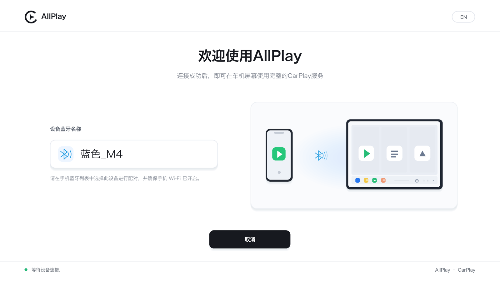
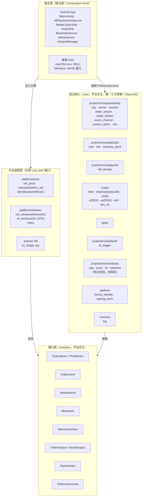
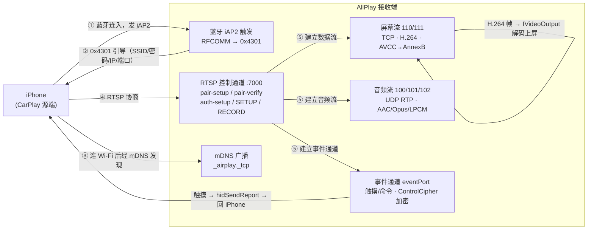

# AllPlay

<div align="left"><a href="README.md">English</a> · <b>简体中文</b></div>

**CarPlay 接收端（无线 + 有线），跨平台。** 一份平台无关的 C++ 协议实现，把 iPhone 的 CarPlay 投到
任意一块屏幕上 —— 视频上屏、音频播放、触摸回传。

**协议核心只写一遍。** 每个平台只实现自己的"屏幕 / 喇叭 / 蓝牙 / 网络"，彼此平级 ——
没有主次平台，也不共享平台代码。

**协议核心正在长成多协议后端。** v1.1 起 `core/projection/` 用 `IProjectionBackend`
统一接入不同投屏协议：CarPlay 是第一个后端，Android Auto 有线的协议与 USB 传输层已落地
（待真机），CarLife / HiCar 预留接口。见 [`docs/projection-backend.md`](docs/projection-backend.md)。

`GPL-3.0` · `Android ✅` · `HarmonyOS ✅` · `Linux ✅` · `macOS ✅` · `Windows ⏳`



---

## 这是什么

CarPlay 本该是 iPhone 和车机之间的私有链路。AllPlay 实现的是**车机那一侧**，两条路都实现了：

**无线**（蓝牙叫醒 → Wi-Fi 投屏）

| 步骤 | 做什么 |
|---|---|
| ① 蓝牙触发 | 连上 iPhone，走 iAP2 把它"叫醒"，并把 Wi-Fi 的 SSID / 密码 / 本机 IP 与端口告诉它 |
| ② 发现 | iPhone 连上同一局域网，经 mDNS（`_airplay._tcp`）发现本机 |
| ③ 协商 | RTSP 控制通道完成配对与流协商：屏幕流 / 音频流 / 事件通道 |
| ④ 投屏 | H.264 屏幕流解码上屏、音频流解码播放、触摸经事件通道回传 |

**有线**（插上数据线就行，不用蓝牙、不用同网段）

| 步骤 | 做什么 |
|---|---|
| ① 认设备 | 把 iPhone 从普通 USB 配置切进 **CarPlay 配置**，打开它的 USBMUX 口 |
| ② 控制面 | usbmux v2 → lockdown 配对 → 原地升 TLS → 起 `com.apple.carkit.service` |
| ③ 谈链路 | 在这条服务流上跑 iAP2：**主机主动发 marker + SYN**（等手机先开口 = 一片死寂）→ 识别 → MFi → 电源与订阅 |
| ④ 递地址 | 收到手机的 `0x4300`，回 `0x4301`，把我们**钉在 USB 网卡上的 IPv6 链路本地地址**和端口告诉它 |
| ⑤ 投屏 | 手机照这个地址连过来，之后和无线那条**完全共用**同一套 RTSP / 加密 / 屏幕流代码 |

> **⚠️ 两条路的最后一道关都需要 Apple MFi 配件身份**（`identity/`）。
> 那是 Apple 签发的凭证，**不在本仓库里**，需自行准备。详见[当前状态](#当前状态)。

**Android Auto（有线，开发中）**：`core/projection/androidauto/` 已实现 AOAP（51/52/53）
→ AAP VERSION → TLS 1.2 → 服务发现 → 通道 / 音视频 / 触摸，平台侧由
`platform/posix/aa_usb_libusb.cpp` 提供 Linux/macOS 共用的 libusb 传输层。
**尚未接宿主 UI、未上真机验证。**

**CarLife / HiCar**：`core/projection/{carlife,hicar}/` 是占位后端 —— 接口齐全，
`probe()` 返回空、`connect()` 明确报未实现。

## 平台支持

| 平台 | 视频上屏 | 音频 | 无线触发 | 有线（USB） | 状态 |
|---|---|---|---|---|---|
| **Android** | MediaCodec 硬解 → Surface | AudioTrack | `BluetoothSocket`（JNI） | — | ✅ 端到端跑通 |
| **HarmonyOS** | AVCodec NDK 硬解 → XComponent surface | OH AudioCodec 解码 → OHAudio 渲染（AAC-LC） | ArkTS `socket.sppConnect` | — | ✅ **真机端到端**（蓝牙触发 → 投屏全屏 → 触摸 → 出声，Mate 60） |
| **Linux / Ubuntu** | ffmpeg 软解 → SDL2 纹理 | SDL2（AAC-LC / Opus / LPCM） | BlueZ：SDP + 裸 RFCOMM（客户端模式） | libusb + 内核 `cdc_ncm` | ✅ **真假两路都端到端跑通** |
| **macOS** | 同 Linux（**共用同一份宿主代码**） | 同 Linux | IOBluetooth | 系统 `usbmuxd` + `AppleUSBNCMData`（不碰 USB，不需要 DriverKit） | ✅ **无线/有线都真机端到端**（有线：iPhone 直插 Mac，投屏 + 声音；无线：蓝牙触发 → 投屏 → 触摸，掉线自动重连） |
| **Windows** | ffmpeg（待接） | — | `AF_BTH`（待接入） | — | ⏳ 骨架 |

有线的媒体面**不自己写**：Linux 上切进 CarPlay 配置后，内核的 `cdc_ncm` 会自己建出一块
真网卡；macOS 上系统本来就用 `AppleUSBNCMData` 把 NCM 功能挂成了 `enX`。两条路都只需
AirPlay 绑到那块网卡上就行，NTB16 / 以太网 / IPv6 都不归我们管。

macOS 的控制面也不碰 USB：借系统 `usbmuxd`（`/var/run/usbmuxd`，就是 Finder 用的那条
隧道）连 lockdown 与 carkit 服务。前提是这台 Mac 已经在 Finder 里被手机信任过。

**Android Auto（有线）**目前只在 Linux / macOS 桌面侧有传输层实现（libusb，
`platform/posix/aa_usb_libusb.cpp`）；协议层本身平台无关，Android / HarmonyOS 宿主
还缺各自的 USB 传输与 UI 入口（见[当前状态](#当前状态)）。

- **没有主次平台。** 各家都只实现 `core/port` 的接口，互相不共享平台代码；
  桌面两平台共用 `host/`，只是因为它们恰好都用 SDL2。
- **验收方式统一。** 不管哪个平台，`tools/fake_phone` 都能扮演 iPhone 跑完整条链路 ——
  不需要真机，也不需要另一台设备。

## 架构

四层，**依赖单向朝内**：

```
host/          宿主层（组合根）—— 装配下面三层，管窗口/主循环/输入
platform/      适配层 —— 用系统 API 实现 core/port 的接口（POSIX / BlueZ / IOBluetooth / Win32 / JNI）
core/port/     接口层 —— 纯抽象，无实现（ITcpStream / IBluetooth / IVideoOutput / MediaKeyQueue …）
core/projection/ 协议后端层 —— IProjectionBackend / IProjectionSession / IProjectionSink；
               CarPlay 在 carplay/（原 airplay / iap2 / mfi / usb / bt），
               Android Auto 在 androidauto/，CarLife / HiCar 占位
core/          协议核心 —— 纯 C++，不含任何平台头，唯一三方依赖是 OpenSSL
```

**只有 `core/` 是"这个项目本身"**：RTSP、iAP2、加密原语、屏幕流、事件通道全在这里，
可以脱离任何平台单独编译和自测。平台差异一律通过 `core/port/*.h` 注入。

反方向的输入（**方控 / 媒体键**）也走同一套分层：`core/port/control.h` 只定义"按了什么键"
和线程安全的 `MediaKeyQueue`，上层把物理按键按进队列，`iap2` 侧（无线 `WirelessTrigger`、
有线 `WiredLink`）负责编码成 HID 报表发回手机。**按键从哪来（界面、系统媒体键、硬件 GPIO）
由各平台自己实现**，`core` 不碰。

<details>
<summary>分层架构图（点击展开）</summary>



</details>

<details>
<summary>无线 CarPlay 数据流（点击展开）</summary>



</details>

逐模块职责与平台适配矩阵见 [`docs/architecture.md`](docs/architecture.md)；
协议细节（报文格式、握手流程）整理在 [`docs/PROTOCOL-NOTES.md`](docs/PROTOCOL-NOTES.md)。

## 快速开始

### 桌面（Linux / Ubuntu 或 macOS）

```bash
bash scripts/bootstrap.sh      # 装依赖：SDL2 / SDL2_ttf / ffmpeg / avahi
                               # （Linux：另加 bluez + dbus-1 + libusb-1.0；
                               #   macOS：Android Auto 有线要 `brew install libusb`）
bash scripts/build.sh          # 产物在 build/
./build/m3_test                # 自测：全绿说明协议核心没问题
./build/aa_wire_test           # Android Auto wire 层自测（AAP 分帧 + protobuf，不需要手机）
```

> **`scripts/*.sh` 在仓库里没有执行位**，所以要写 `bash scripts/xxx.sh`，直接 `./scripts/build.sh` 会 permission denied。

启动宿主。三种用法：

```bash
# ① 等手机来连（传统接收端）
./build/allplay_host --name "AllPlay"

# ② 主动把手机叫来（蓝牙 iAP2 触发 → 再接住它投过来的画面）
./build/allplay_host --statusbar \
  --bt --bt-device iPhone --ssid "<你的 Wi-Fi 名>" --wifi-pass "<密码>"

# ③ 有线（插着数据线，不用蓝牙、不用同网段）—— 见下面"前置条件"
./build/allplay_host --wired --identity identity
```

- `--bt` / `--wired` 系列开关**一律 opt-in**，不加就跟纯接收端的行为完全一致；两者互斥。
- 用 `--bt-addr AA:BB:CC:DD:EE:FF` 按蓝牙地址直连，比按名字匹配可靠。
- 触发失败会按 3 秒间隔整链重试（`--bt-retry`，默认 10 次）；运行时按 `B` 可再触发一次。
  有线准备失败时按 `W` 重来一次（解锁手机、点掉"信任"弹窗之后不用重启程序）。
- **同网段若还有别的 CarPlay 接收端**（自带 MFi 的车机等），iPhone 有自动回连行为，
  可能连到它那边去 —— 测本机时建议先把那台断电。

#### 有线的前置条件（Linux，**缺一不可**）

```bash
# ① 我们自己要独占 USBMUX 口，系统那套 usbmuxd 得让开
sudo systemctl stop usbmuxd && sudo systemctl mask usbmuxd
# ② 不然 gvfs 会抢着去挂载 iPhone 的照片
pkill -f gvfsd-gphoto2
# ③ 挡掉内核的 apple_mfi_fastcharge —— 它会把设备认走
echo "blacklist apple_mfi_fastcharge" | sudo tee /etc/modprobe.d/blacklist-apple-mfi.conf
```

**整个程序要 `sudo` 跑**（`/dev/bus/usb/*` 是 root 独占）。注意 `sudo` 会重置环境：

```bash
sudo env ALLPLAY_LOG=info ALLPLAY_STATE_DIR="$HOME/.local/state/allplay" \
  ./build/allplay_host --wired --identity identity
```

`ALLPLAY_STATE_DIR` 必须显式给 —— 不然 `HOME` 变成 `/root`，本机身份会另起一份，
手机每次都要重新配对。

两个"看起来像故障、其实不是"的现象：**手机锁屏时只报 1 个 USB 配置**（iOS 的行为，
不是线的问题，解锁就好）；**首次连接手机会弹"信任此电脑"**，没人点的话约 40 秒后它会把
USB 整个重置掉，日志里看到的是设备消失而不是超时。

跑起来之后就是这样（真 iPhone，插线，宿主 `--wired`）：


**触摸也通**，而且走的是和无线**完全相同**的那条事件通道（`POST /command` + 加密 HID），
一行都没改 —— 下面这张是注入一次点击打在"外观"那一行上，手机跟着进了该页：


> 音频在有线上没验过：那一次会话里手机没有建音频流（CarPlay 只在真的出声时才建）。
> 代码路径与无线共用，但**没上真机点过就不算数**。

### 端到端验收（**不需要 iPhone**）

用 `tools/fake_phone` 扮演 iPhone，真 socket + 真加密跑完整条 RTSP 与屏幕流：

```bash
# 先造一段测试流
ffmpeg -f lavfi -i testsrc2=size=1280x720:rate=60 -t 10 -c:v libx264 \
  -preset veryfast -pix_fmt yuv420p -g 60 -bf 0 -bsf:v h264_mp4toannexb -f h264 out.h264

# 终端 1：宿主（--port 7100 避开下面那个坑）
SDL_VIDEODRIVER=dummy SDL_AUDIODRIVER=dummy ./build/allplay_host \
  --no-avahi --port 7100 --dump /tmp/x.ppm

# 终端 2：假 iPhone
./build/fake_phone --h264 out.h264 --port 7100 --fps 60
```

**验收看四个数**：`fake_phone` 打印的触摸坐标对得上注入值；音频推流帧数对得上宿主解码帧数；
`--dump` 出的 PPM 转 PNG 是彩条且**红是红**（红蓝互换 = YUV 平面序写错了）；`m3_test` 仍全绿。

### Android

```bash
cd android && ./gradlew :app:assembleDebug      # 需要 Android SDK + NDK + 为 arm64-v8a/armeabi-v7a 交叉编译的 OpenSSL
```

`minSdk 19`（Android 4.4+）、`targetSdk 34`、ABI 出 `arm64-v8a` + `armeabi-v7a`（32 位盒子用后者）。
NDK 需用 **r25c**（r26 起不支持 API 19）；OpenSSL 按 ABI 分目录（`openssl-arm64` / `openssl-arm`）。
交叉编译说明见 `android/app/src/main/cpp/CMakeLists.txt` 顶部。

### HarmonyOS（鸿蒙）

```bash
scripts/build-ohos-openssl.sh                   # ① 交叉编译 OpenSSL（产物在 tmp/ohos-ssl/，不入库）
scripts/sync-harmony-identity.sh                # ② 把 identity/ 拷进 HAP 的 rawfile（已在 .gitignore）
cd harmony && hvigorw assembleHap --mode module -p product=default
hdc install -r entry/build/default/outputs/default/entry-default-signed.hap
```

- 需要 **DevEco Studio**（HarmonyOS SDK + NDK），`harmony/build-profile.example.json5` 是签名配置的模板
  —— 复制成 `harmony/build-profile.json5` 填自己的证书，真实配置不入库。
- 协议全在 `core/`，经 NAPI 编进 `liballplay_core.so`；蓝牙 SPP、mDNS 广播、屏幕尺寸走 ArkTS 系统 API。
- **视频**：`OH_VideoDecoder_CreateByMime` 硬解（NDK AVCodec），直接 `RenderOutputBuffer` 到
  `XComponent` 的 surface。avcC 会转成 AnnexB 的 SPS/PPS 在每个 IDR 前 in-band 补一份
  （`OH_MD_KEY_CODEC_CONFIG` 这条路在真机上没进解码器）。
- **全屏**：按屏幕长宽比协商显示分辨率（如 1920×868），iPhone 会按这个尺寸重排 CarPlay 界面，
  横屏后 1:1 铺满；启动页仍是竖屏。
- **触摸**：XComponent `onTouch` → 归一化坐标 → `core` 的事件通道 → HID `touchReport`（双触点）。
- **音频**（`harmony_audio.cpp`）：`OH_AudioCodec` 同步模式解码 → `OHAudio` 渲染。
  手机给的是**裸 AAC 帧**（type=102、`0x800000`、48kHz 立体声），每帧前面自己补 7 字节 ADTS 头，
  并把 `OH_MD_KEY_AAC_IS_ADTS` 置 1 —— 走带外 ASC 那条路在这台机的解码器上解不出东西。
  播放侧是 1.5s 的环形池 + 700ms 续播水位，Wi-Fi 抖动和手机的成团发送都靠它吸收。
  流式播放时界面上的"取消"会被画面盖住。

## 当前状态

| 里程碑 | 内容 | 状态 |
|---|---|---|
| M0 | 骨架：CMake + SDL 窗口/状态栏 + 脚本 | ✅ |
| M1 | core：RTSP + `/info`(bplist) + mDNS 广播 `_airplay._tcp` | ✅ |
| M2 | 蓝牙触发：iAP2 协议栈（识别 / MFi / 订阅 / 0x5703 / 0x4301） | ✅ 软件完成；**Linux BlueZ 接通真机 iPhone，整链走到 `0x4301 CarPlayStartSession`** |
| M3 | 会话 + 视频：pair-setup/verify、auth-setup、SETUP、ControlCipher、屏幕流 | ✅ 安卓端到端（含 Android 4.4 盒子）；✅ 桌面 ffmpeg 解码上屏；✅ **真 iPhone 在 Ubuntu 桌面上跑通（2026-10-12）** |
| M4 | 有线（USB）CarPlay：libusb 切配置 + usbmux/lockdown/TLS + 内核 `cdc_ncm` 媒体面 | ✅ **真 iPhone 有线端到端跑通（2026-10-13），宿主 `--wired`** |
| M5 | 状态栏信息 + 健壮性（重连 / 关键帧恢复 / watchdog） | 部分（关键帧恢复已接） |
| M6 | UI 状态页 / 叠加（原生） | |
| M7 | 协议后端化：`IProjectionBackend` + 注册表 + CarPlay 模块（v1.1） | ✅ 编译与回归通过；宿主尚未切到注册表 |
| M8 | Android Auto 有线：AOAP → AAP → TLS 1.2 → 音视频/输入（v1.1） | 🟡 协议 + libusb 传输层完成，**待真机**；宿主未接 UI |

> **两条路都通了。** 无线：2026-10-12 蓝牙触发 → mDNS 发现 → RTSP 协商 → 屏幕流上屏 → 触摸可点
> （见 [`CHANGELOG.md`](CHANGELOG.md) v0.3）。有线：2026-10-13 插线即通，控制面自己写、
> 媒体面交给内核，200 秒连续收流不掉线（见 v0.4）。
> 剩下的阻塞在**凭证**上：iAP2 的 `0xAA00 请求证书` 要求 Apple MFi 计划签发的配件身份
> （`identity/`）。开发期用自备身份即可走通全链路做验证，但**纯软件身份不是产品路径**。

版本历史见 [`CHANGELOG.md`](CHANGELOG.md)。

### 自测

| 命令 | 覆盖 | 需要硬件 |
|---|---|---|
| `./build/core_selftest` | M1：RTSP + `/info` + mDNS 广播 | 否 |
| `./build/iap2_test identity` | M2：iAP2 线格式 + 链路层 + **MFi 签名** | 否，但**需要 `identity/`** |
| `./build/m3_test` | M3：SRP 参考向量 + 假手机全流程 + 屏幕流 | 否 |
| `./build/aa_wire_test` | Android Auto wire：AAP 分帧/拼帧 + protobuf 子集 | 否 |
| `./build/video_probe --h264 x.h264` | 解码 + letterbox 上屏冒烟 | 否 |
| `./build/wired_probe --selftest` | 有线：lockdown plist / 证书 / TLS 回环（**不用插手机、不用 sudo**） | 否 |
| `./build/allplay_host` + `./build/fake_phone` | 端到端 | 否 |
| `./build/wired_probe --link --mfi-dir identity` | 有线控制面（要真 iPhone + sudo + 上面那三件前置） | 是 |

不带参数跑 `--help` 都能看到各自的完整选项。

## 仓库结构

```
core/          协议核心（平台无关，唯一三方依赖 OpenSSL；无任何平台头）
  projection/    协议后端（backend.h / registry + carplay / androidauto / carlife / hicar）；
                 CarPlay 的 airplay·iap2·mfi·usb·bt 原样收进 projection/carplay/
  port/          抽象接口：IByteStream / ITcpListener·ITcpStream / IBluetooth /
                 IMdnsAdvertiser / INetworkInfo / IVideoOutput + PlatformServices 组合根注入
  crypto/ bplist/ 通用协议设施（加密原语 / 二进制 plist）
platform/
  posix/         Linux + macOS 适配（socket / avahi·dns_sd / bluez·IOBluetooth /
                 libusb（CarPlay 有线 + Android Auto）·usbmuxd+AppleUSBNCMData）
  windows/       Winsock2 / AF_BTH
android/         Android 工程（Gradle：Kotlin + NDK C++ core + JNI → 系统 API）
harmony/         HarmonyOS 工程（ArkTS + hvigor：core 经 NAPI 进 HAP，AVCodec 硬解 → XComponent）
host/            桌面宿主（SDL2 / ffmpeg）
  bt_task          无线触发任务（--bt：主动把手机叫起来）
  wired_task       有线接入任务（--wired：USB 控制面两段式，见该文件顶部）
  media/           ffmpeg 软解 + SDL 视频/音频 sink
tools/           自测与验收工具（core_selftest / iap2_test / m3_test / aa_wire_test /
                 fake_phone / video_probe / usb_probe / wired_probe）
docs/            架构说明 · 协议笔记 · 截图（images/）
scripts/         bootstrap / build / deploy / 检查脚本
```

**`identity/` 不在仓库里**（见 `.gitignore`）。它是 Apple 签发的 MFi 配件凭证，属敏感文件：
不要拷去别处、不要进任何仓库；`scripts/deploy.sh` 同步到目标机时会带上它（目标机运行必需），
但同步别的东西时记得 `--exclude 'identity'`。

## 依赖

原则是**只用系统库**，不引入需要自行构建的第三方。

| 组件 | 依赖 | 许可 |
|---|---|---|
| `core/` | OpenSSL（唯一三方依赖） | Apache-2.0 |
| 桌面宿主 | SDL2 + SDL2_ttf、ffmpeg（libavcodec / libavutil / libswscale） | zlib / LGPL-2.1+ |
| Linux 适配 | avahi-client、bluez（libbluetooth）、dbus-1、libusb-1.0（有线 CarPlay / Android Auto，缺则跳过） | LGPL-2.1+ |
| macOS 适配 | IOBluetooth / CoreWLAN / dns_sd（系统框架） | 系统 |
| macOS 适配 | libusb-1.0（Android Auto 有线，缺则跳过） | LGPL-2.1+ |
| Android | SDK / NDK（BluetoothSocket、MediaCodec、AudioTrack、NsdManager） | 系统 |

**有意不用**的两个：`libswresample`（见 `host/media/ffmpeg_compat.h` 顶部说明）、
`fdk-aac`（音频一律走 ffmpeg 自带解码器）。`libavformat` 本项目用不到。

## 许可与致谢

本项目以 **GPL-3.0** 发布，是 **DiPlay** / **xcertplay**（同为 GPL-3.0）CarPlay 接收端的
**C++ 重新实现**。v1.1 起扩展为多协议后端架构；Android Auto 的协议事实参考
**AASDK / OpenAuto**（GPL-3.0），是独立编写、未拷贝其源码。许可全文见 [`LICENSE`](LICENSE)，
上游署名与三方组件许可见 [`THIRD_PARTY_NOTICES.md`](THIRD_PARTY_NOTICES.md)。

## 排障

- **窗口起不来 / 字体缺失**（桌面）：`bash scripts/bootstrap.sh` 会装 `fonts-dejavu-core`。
- **宿主编译正常但一直黑屏**：先用 `./build/video_probe --h264 x.h264` 二分 ——
  有画面说明是协议侧的问题，没画面是解码侧的问题。
- **`:7000` 起不来**：macOS 的 `ControlCenter`（隔空播放接收器）常年占着 7000，
  宿主会静默改用 7001，而假手机默认连 7000 → **两边都显式 `--port 7100`**。
- **手机压根不来连**（日志里一行 RTSP 都没有 —— 注意区别于"连上又断"）：先查 mDNS 的 TXT 记录
  是不是真的键值 —— `avahi-browse -t -r -p _airplay._tcp | grep -i allplay`，应看到
  `deviceid=` / `features=` / `flags=0x4` / `srcvers=` / `pi=`。iPhone 靠这些字段认接收端，
  缺了就不连。对照：同网段的 Mac 广播的是 `flags=0x204`，CarPlay 接收端才是 `flags=0x4`。
- **看状态栏**：宿主加 `--statusbar`，左下状态点 = 状态（灰=空闲、黄=等配对、绿=视频流、红=错误），
  右侧 = 分辨率 / fps / 帧数 / 音频欠载次数。**静态页面下 fps 掉到 0 是正常的** ——
  AirPlay 屏幕流是画面变了才发帧，不是卡死。
