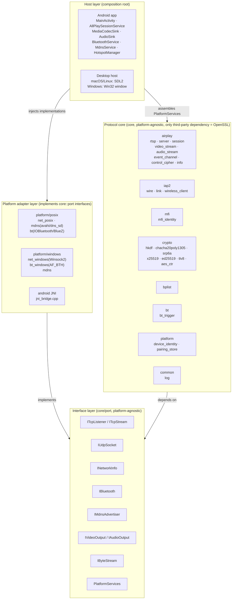
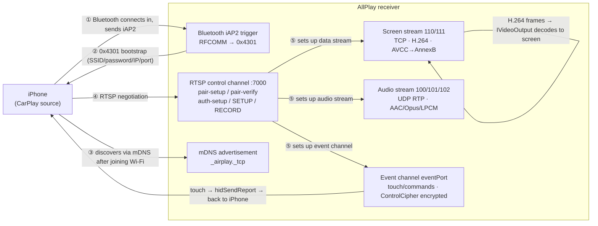

# AllPlay Architecture

<div align="left"><b>English</b> · <a href="architecture.zh-CN.md">简体中文</a></div>

> Diagrams are Mermaid; they render directly on GitHub, in VS Code (with the Mermaid
> extension), and in Typora.
> The README covers "what this is and how to run it"; this document covers **rules and
> contracts** — the part you should know before changing code.

## 1. Layers and the four rules



**The four rules** (use them to decide where a change belongs):

1. **No platform headers in `core/`.** Do not include `<sys/socket.h>` / `<SDL.h>` /
   `<jni.h>`; the only third-party dependency is OpenSSL. `core/` must build without any
   platform — `m3_test` / `iap2_test` are living proof (they link only `allplay_core`).
2. **Platform differences go through `core/port/*.h` only.** Need a new capability (say,
   reading battery level)? Define the interface in `core/port/` first, then implement it
   per platform — **not** with `#ifdef __ANDROID__` inside core.
3. **The host layer is the only composition root.** Nobody knows better than the host
   which Bluetooth implementation this machine should use. `host/main.cpp`,
   `android/.../jni_bridge.cpp`, and each `tools/*.cpp` assemble their own.
4. **Dependencies point inward, one way.** `host → platform → port ← core`. core does not
   know platform; platform does not know host.

## 2. Wireless CarPlay data flow



Step ① is **client mode**: we actively connect to the iPhone's iAP2 SPP service
(`00000000-deca-fade-deca-deafdecacafe`), rather than waiting for the phone to connect to
us. That is how the head unit side is supposed to work — the phone only proceeds after it
receives our connection.

## 3. Core module responsibilities

| Module | Responsibility |
|---|---|
| `airplay/rtsp` | Minimal RTSP server (control channel; fully encrypted after pair-verify) |
| `airplay/server` | `Receiver`: the façade above the composition root; starts RTSP + mDNS advertisement and owns `PlatformServices` |
| `airplay/session` | Session state machine: pair-setup / pair-verify / auth-setup / SETUP / RECORD |
| `airplay/video_stream` | Screen stream: 128B header decryption → AVCC→AnnexB → keyframe gate |
| `airplay/audio_stream` | Audio stream: RTP over UDP decryption + out-of-order sequence reordering |
| `airplay/event_channel` | Event channel: touch HID reports (up to 2 contacts) + `/command` commands |
| `airplay/control_cipher` | Control-channel frame encryption (ChaCha20-Poly1305, independent counters per direction) |
| `airplay/info` | bplist response for `/info` (device identity, public key, supported streams) |
| `iap2/wire` | iAP2 wire format: TLV parameter encoding/decoding, CSM deframing |
| `iap2/link` | iAP2 link layer: marker→SYN→ACK→NORMAL handshake, sequence numbers and checksums |
| `iap2/wireless_client` | Bluetooth-side control flow (`0xAA00`~`0xAA05` / `0x1D00` / `0x5703` / `0x4301`) |
| `mfi/mfi_identity` | MFi accessory identity (certificate + ECDSA signature). **The interface follows the shape of the hardware chip**, so swapping chips does not touch core |
| `crypto/*` | All cryptographic primitives implemented from scratch; no third-party protocol libraries |
| `bplist` | Apple binary plist encoder/decoder |
| `bt/bt_trigger` | Bluetooth trigger orchestration: pick device → RFCOMM → iAP2 → `0x4301` bootstrap |
| `platform/device_identity` | Local AirPlay identity (Ed25519 key pair) — a **different thing** from the MFi identity |
| `platform/pairing_store` | Pairing record persistence (who has paired, shared keys) |

## 4. Interface-layer contracts

### `core::PlatformServices` (capability bundle injected by the composition root)

```cpp
struct PlatformServices {
    INetworkInfo* network;      // NIC IP/MAC — used by AirPlay advertisement and 0x4301 bootstrap
    IBluetooth*   bluetooth;    // Bluetooth trigger; may be null if not triggering
    std::function<std::unique_ptr<ITcpListener>()>    makeTcpListener;      // one per use
    std::function<std::unique_ptr<IMdnsAdvertiser>()> makeMdnsAdvertiser;
    std::function<std::unique_ptr<IUdpSocket>()>      makeUdpSocket;
};
```

Factories are `std::function` because listeners / advertisers must be created "one per
use" (RTSP, data, and event each get their own port).

> ⚠️ **`Receiver` keeps its own copy of `PlatformServices`** rather than storing the
> caller's pointer. The reason: `Session` first uses `makeTcpListener` at SETUP, long
> after `start()` has returned — storing the address would leave a dangling pointer, and
> the symptom is a SIGSEGV during SETUP.

### `core::IVideoOutput`

| Method | Contract |
|---|---|
| `configure(codec, w, h, codecData)` | `codecData` = **the avcC/hvcC record body with the fourcc stripped** (first byte `0x01`). `w/h` are negotiated values only; the real resolution comes from the SPS in the stream. **May be called repeatedly** — if the config is unchanged you must skip rebuilding, otherwise you get periodic black frames |
| `feedAnnexB(data, len)` | Feed an AnnexB frame. **Returning `false` is expensive** — core re-arms the gate and immediately requests a keyframe from the phone. Return false only when the decoder is genuinely unusable |
| `reset()` | Keyframe recovery: clear the decoder + **clear the frame queue** (otherwise stale frames keep showing after recovery) |
| `flush()` | Clear the reference chain before a new IDR. core does not call this today |

### `core::IAudioOutput`

`configure()` is called once each time the audio stream is rebuilt at SETUP; `feed()`
delivers **raw frames** — AAC-LC without an ADTS header (and it will also feed config
packets of ≤12 bytes, which must be ignored), raw Opus packets, raw LPCM. `sample` is the
RTP timestamp, used for reordering and clocking.

### `core::IBluetooth`

`pairedDevices()` / `connectRFCOMM(addr, uuid, err)` / `waitForPhoneConnection()`.
**The returned stream is not owned by the caller** — do not delete it.

## 5. Threading model (the easiest place to get this project wrong)

`core` starts these threads:

| Thread | Started in | Which of your callbacks it calls |
|---|---|---|
| RTSP accept | `rtsp.cpp:135` | one handler thread per connection |
| ScreenStream | `video_stream.cpp:30` | `IVideoOutput::configure()` + `feedAnnexB()` |
| AudioStream | `audio_stream.cpp:44` | `IAudioOutput::feed()` |
| EventChannel | `event_channel.cpp:110` | — |
| Keyframe / NTP / keep-alive | `session.cpp:451 / 472 / 504` | — |

**The critical asymmetry** (we hit this once; see the fix in CHANGELOG v0.2):

| Callback | Called from which thread |
|---|---|
| `IVideoOutput::configure()` / `feedAnnexB()` | **ScreenStream thread** |
| `IVideoOutput::reset()` | **RTSP thread** (triggered by `/command forceKeyFrame` or a dropped keyframe) |
| `IAudioOutput::configure()` | **RTSP thread** (inside SETUP) |
| `IAudioOutput::feed()` | **AudioStream thread** |

In other words, **`reset()` and `feedAnnexB()` are two threads** touching the same decoder
state — platform implementations **must do their own locking**; core does not.

One more existing convention: **SDL is only called on the main thread**. So audio device
open/close cannot happen directly in `configure()` (RTSP thread); instead set an atomic
pending flag and let the main loop handle it. See the comments in
`host/media/sdl_audio_sink.cpp` for how the host side actually does it.

## 6. Platform adapter matrix

| Capability | Linux | macOS | Android | Windows |
|---|---|---|---|---|
| TCP / UDP | POSIX socket ✅ | POSIX socket ✅ | Socket ✅ | Winsock2 ✅ |
| NIC info | `getifaddrs` ✅ | `getifaddrs` ✅ | `NetworkInterface` ✅ | `GetAdaptersAddresses` ✅ |
| Bluetooth | **BlueZ** (SDP + raw RFCOMM, client mode) ✅ verified on device up to `0xAA00` | IOBluetooth ⏳ not yet verified on device | `BluetoothSocket` ✅ | `AF_BTH` ⏳ skeleton |
| Wired (USB) | libusb config switch + usbmux v2 + kernel `cdc_ncm` ✅ end-to-end on device | system `usbmuxd` + `AppleUSBNCMData` (no USB access, no DriverKit needed) ✅ end-to-end on device (video + audio) | — | — |
| mDNS | avahi ✅ | dns_sd ✅ | `NsdManager` ✅ | ⏳ TODO |
| Video output | ffmpeg software decode + SDL2 ✅ | ffmpeg software decode + SDL2 ✅ | MediaCodec hardware decode ✅ | ffmpeg ⏳ TODO |
| Audio output | SDL2 (AAC-LC / Opus / LPCM) ✅ | SDL2 ✅ | AudioTrack ✅ | ⏳ TODO |
| Desktop host | ✅ end-to-end working | ✅ end-to-end working | — (native app) | ⏳ window only |

Corresponding implementation files:

```
platform/posix/  net_posix.cpp      mdns_avahi.cpp | mdns_dns_sd.cpp
                 bt_bluez.cpp      | bt_iobluetooth.mm
                 usb_libusb.cpp    | usbmuxd_mac.cpp
platform/windows/ net_windows.cpp   bt_windows.cpp
android/.../cpp/  jni_bridge.cpp
```

## 7. What it takes to add a new platform

In dependency order; every step can be verified on its own:

1. **`net`**: implement `INetworkInfo` + `ITcpListener`/`ITcpStream` + `IUdpSocket`.
   Verify: `core_selftest` starts and `/info` responds.
2. **`mdns`**: implement `IMdnsAdvertiser` (advertise `_airplay._tcp`).
   Verify: `avahi-browse -t _airplay._tcp` (or the platform's equivalent) can see it.
3. **`video`**: implement `IVideoOutput`. **Do not touch the protocol yet** — use the
   approach from `tools/video_probe` to feed a local H.264 clip and get
   "decode + display" working before moving on.
4. **`audio`**: implement `IAudioOutput` (three formats; at minimum it must ignore AAC
   config packets).
5. **`bluetooth`**: implement `IBluetooth`. On Linux it is **client mode** (we connect to
   the phone); do not write it as "server waiting for the phone to connect".
6. **Host**: assemble the pieces above into `PlatformServices` + `ReceiverConfig` and
   start the main loop.
7. **Acceptance**: run `tools/fake_phone` end-to-end (no iPhone needed), then verify the
   Bluetooth part on a real device.

## 8. Multi-protocol evolution (draft)

CarPlay currently lives directly in directories such as `core/airplay` / `core/iap2`. To
make the same `core` also serve Android Auto / CarLife / HiCar, the route is
**protocol backendization**: the host depends only on
`core::projection::IProjectionBackend`, CarPlay is the first backend, and the rest plug
into the same interface. See [projection-backend.md](projection-backend.md) for the
interface draft and migration plan.

Current status (2026-11-08):

| Backend | Code | Status |
|---|---|---|
| CarPlay | `core/projection/carplay/` (`backend_carplay` wraps the existing airplay/iap2/mfi/usb/bt) | modules in place; host not switched yet |
| Android Auto (wired) | `core/projection/androidauto/` + `platform/posix/aa_usb_libusb.cpp` | compiles; awaiting hardware |
| CarLife | `core/projection/carlife/` | placeholder (interface complete, not implemented) |
| HiCar | `core/projection/hicar/` | placeholder (interface complete, not implemented) |

AA's wired path is AOAP (51/52/53) → AAP VERSION → TLS 1.2 (records wrapped in 0x0003) →
service discovery → channels / audio-video / input. Only the protobuf wire subset is
implemented (`proto.h`); TLS uses system OpenSSL, with no protobuf / Boost / AASDK code
pulled in.
