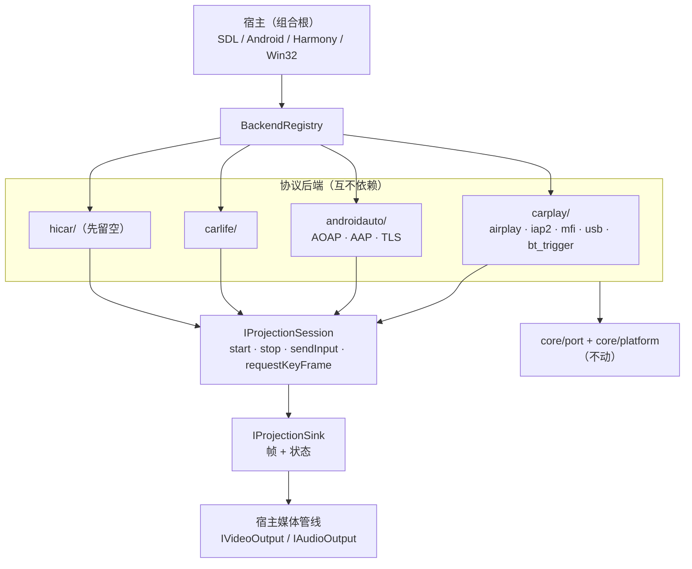

# 多协议后端：架构草案（CarPlay → +Android Auto / CarLife / HiCar）

> 本文是**方案**，不是已完成的实现。接口草案见 [`core/projection/backend.h`](../core/projection/backend.h)。
> 目标：把"协议栈"变成可替换的后端，宿主只面向一套门面。第一个后端就是现有的 CarPlay，
> **行为零变化**；之后再逐个接 Android Auto、CarLife、HiCar。

## 一、为什么现在动

`core` 目前约 1 万行，全部服务于 CarPlay。问题不在"代码写得像 CarPlay"——`core/port`
和 `IVideoOutput`/`IAudioOutput` 本来就是协议无关的——而在**边界**：

- `core/airplay/server.cpp` 的 `Receiver` 同时是"协议栈"和"组合根"：起 RTSP、发 mDNS、
  持 `PlatformServices`、管会话。第二套协议没有地方挂。
- 宿主（`host/wired_task.cpp`、`jni_bridge.cpp`、鸿蒙 `napi_bridge.cpp`）直接认识
  `WiredControl` / `Receiver` / `bt_trigger`，协议细节漏到了组合根。
- 触摸是 `event_channel` 里的 HID report，没有协议中立的输入语义。

越晚拆，`core` 里 CarPlay 专属代码越多，拆的代价越大。现在是最便宜的窗口。

## 二、目标分层



设计规则：

1. **接口里不出现协议词汇。** 没有 `pairVerify()`、`startSession()`、`AOAP`，只有
   `start/stop/sendInput/onVideoFrame/onState`。跨协议都需要的能力才进接口。
2. **媒体面不搬。** 解码/渲染仍在宿主（`IVideoOutput`/`IAudioOutput`），后端只交帧。
   四家视频都是 H.264（HiCar 可能 HEVC），音频是 AAC 系 / Opus / LPCM，现有枚举够用。
3. **组合根不变。** `PlatformServices` 仍由宿主装配，经 `connect()` 注入后端。
4. **后端之间不互相 include。** CarPlay 后端不 import AA 的任何东西。

## 三、接口契约（摘要）

完整定义见 `core/projection/backend.h`，这里只记**必须遵守**的部分。

### 生命周期

```text
probe() → ProjectionTarget
connect(target, services, sink) → IProjectionSession
session.start()        // 立即返回，握手在内部线程
   → sink.onState(Connecting / Negotiating / Running)
session.stop()         // 幂等；返回后不再有回调
```

- `start()` **不阻塞**。有线 CarPlay 的 iAP2 握手、无线 CarPlay 的 BT 触发 + RTSP 协商
  都很慢，放进内部线程，进度用 `onState` 报。
- `connect()` 失败返回 `nullptr` 并写 `err`；`start()` 之后的失败走
  `onState(Failed, detail)`，不抛异常。

### 线程

| 调用 / 回调 | 线程 | 约定 |
|---|---|---|
| `probe()` / `connect()` | 调用方 | 可能慢（ioreg / USB 枚举 / mDNS） |
| `start()` / `stop()` | 调用方 | `stop()` 返回后保证无回调 |
| `sendInput()` / `requestKeyFrame()` | 任意 | 实现内部加锁 |
| `onVideoConfig` / `onVideoFrame` | 后端视频线程 | 与音频、状态**可能并发** |
| `onAudioConfig` / `onAudioFrame` | 后端音频线程 | 同上 |
| `onState` | 后端控制线程 | 同上 |

这正是现有 `docs/architecture.md` 第五节那张"不对称表"的推广：**Sink 实现自己加锁，
后端不管**。

### 输入

`InputEvent` 只有三种：Touch（归一化坐标 + 触点号）、Key（语义键值）、Rotary（格数）。
各家翻译：

| 协议 | 触摸来源 | 按键 / 旋钮 |
|---|---|---|
| CarPlay | `event_channel` 的 HID report | `session.cpp` 的 media/voice 键 |
| Android Auto | AAP input channel | AAP input channel |
| CarLife | 私有协议 | 私有协议 |
| HiCar | 私有协议 | 私有协议 |

`Capabilities` 让 UI 在连接前就知道该显示哪些控件。

## 四、目录迁移

### 目标布局

```text
core/
├── projection/
│   ├── backend.h                 # 接口（本次草案）
│   ├── registry.cpp              # 协议注册表
│   ├── carplay/
│   │   ├── backend_carplay.{h,cpp}   # 适配层：包 Receiver / WiredControl
│   │   ├── airplay/              # ← core/airplay 整体搬
│   │   ├── iap2/                 # ← core/iap2 整体搬
│   │   ├── mfi/                  # ← core/mfi 整体搬
│   │   ├── usb/                  # ← core/usb 整体搬（含 mux.h）
│   │   └── bt_trigger.*          # ← core/bt 整体搬
│   ├── androidauto/              # Phase 3
│   ├── carlife/
│   └── hicar/
├── crypto/                       # 不动：通用原语（AA 的 TLS 也用得上）
├── bplist/                       # 不动：通用格式
├── platform/                     # 不动：device_identity / pairing_store
├── port/                         # 不动
└── common/                       # 不动
```

### 搬迁对照

| 现有 | 去向 | 说明 |
|---|---|---|
| `core/airplay/*` | `core/projection/carplay/airplay/` | RTSP、session、流、事件通道、控制加密 |
| `core/iap2/*` | `core/projection/carplay/iap2/` | wired/wireless 链路 |
| `core/mfi/*` | `core/projection/carplay/mfi/` | MFi 身份 |
| `core/usb/*` | `core/projection/carplay/usb/` | usbmux、wired_control、pair_record |
| `core/bt/bt_trigger.*` | `core/projection/carplay/` | 无线触发是 iAP2 专属 |
| `core/crypto/*`、`core/bplist/`、`core/platform/`、`core/port/`、`core/common/` | 不动 | 通用 |

**include 路径**：搬迁后给 `allplay_core` 增加 include 目录 `core/projection/carplay`，
这样内部的 `#include "airplay/session.h"`、`"iap2/wire.h"` 都不用改，搬迁是纯 `git mv`。

## 五、分阶段落地

### 进度（2026-11-08）

- ✅ 接口 + 注册表：`core/projection/backend.h`、`registry.cpp`。
- ✅ CarPlay 后端：`core/projection/carplay/backend_carplay.{h,cpp}`，无线/有线会话
  都包在里面；`airplay / iap2 / mfi / usb / bt` 已整体 `git mv` 到
  `core/projection/carplay/`（include 路径兼容，协议代码零改动）。
- ✅ Android Auto 有线：`core/projection/androidauto/` 完成 AOAP → AAP VERSION →
  TLS 1.2 → 服务发现 → 通道 / 音视频 / 输入；`platform/posix/aa_usb_libusb.cpp`
  提供 libusb 端口（Linux + macOS 共用）。**编译通过，尚未上真机验证。**
- 🟡 宿主仍走老的 `WiredTask` / `BtTask` / `Receiver`，还没切到
  `BackendRegistry::connect()`；AA 也还没有 UI 入口 —— 这是下一步。
- 🟡 CarLife / HiCar：`core/projection/{carlife,hicar}/backend_*.cpp` 是占位后端，
  `probe()` 返回空、`connect()` 报"未实现"，接口已经能被注册表接纳。

### Phase 0（已完成）：只给接口

- 新增 `core/projection/backend.h` 与本文件；不接 CMake、不改宿主、不动现有代码。
- 验收：`clang++ -fsyntax-only -Icore` 通过；现有构建与真机行为不变。

### Phase 1：CarPlay 后端适配层（不动目录）

新增 `core/projection/carplay/backend_carplay.{h,cpp}`，把现有两套流程包进接口：

- **有线**：`probe()` 用 `listUsbPhones` / ioreg 找 iPhone；`connect()` 起内部线程跑
  `openSystemUsbMuxd` / `openWiredCarPlay` + `WiredControl`，把音频帧转给
  `sink.onAudioFrame()`，视频帧转给 `sink.onVideoFrame()`，触摸走 `sendInput()`。
- **无线**：`probe()` 返回已配对的蓝牙手机；`connect()` 起 `bt_trigger` + `Receiver`，
  `Receiver` 的 `IVideoOutput`/`IAudioOutput` 由适配层实现成转发到 `sink` 的桥。

宿主改动：

- `host/wired_task.cpp` 与无线路径改为 `registry.find(Protocol::CarPlay)->connect(...)`；
  行为、命令行、日志保持原样。
- Android / 鸿蒙宿主**先不动**（它们内部仍直接调 core），等 Phase 2 再统一。

验收（必须全过）：

1. `allplay_host --wired` 真机：投屏 + 声音 + 触摸，和现在一致；
2. 无线链路：蓝牙触发 → RTSP → 按键/触摸，和现在一致；
3. 断线重连、`0x4301` 重发、音频字节交换全部回归通过；
4. 宿主代码不再直接 include `airplay/`、`iap2/`、`usb/` 头。

### Phase 2：目录搬迁 + 注册表

- 按上表 `git mv`，补 include 目录；`BackendRegistry` 实现；宿主加 `--protocol`。
- 纯机械改动，编译 + Phase 1 的回归全部重跑。

### Phase 3：Android Auto 有线（第二个后端）

- 新代码 `core/projection/androidauto/`：AOAP（USB 控制请求 51/52/53）→ AAP VERSION →
  TLS 1.2（记录装在 0x0003）→ 服务发现 → AAP protobuf 通道（control / video / audio /
  input / sensor）。
- 参考实现：AASDK / OpenAuto。
- 验收：真机 Android 手机，投屏 + 声音 + 触摸。

> ⚠️ 平台前提：macOS 的有线 CarPlay 能成，是因为"不碰 USB"，只借系统 usbmuxd。
> **AA 没有等价守护进程**——AOAP 必须自己持有 USB 设备。现状是 Linux 与 macOS
> 都用 libusb（macOS 上用户态可以打开非 Apple 设备，不需要 DriverKit）；同一个
> USB 口上，CarPlay（NCM/usbmuxd）与 AA（AOAP）互斥，需要"先探测、再声明、失败
> 可回退"的端口仲裁。

### Phase 4+：CarLife、HiCar

- CarLife：协议不公开，需要真机抓包，不确定性高（估 4–8 周，可能卡住）。
- HiCar：没有华为文档/合作，逆向成本不封顶。**接口留好，不排期。**

## 六、开放问题（决策点）

1. **USB 端口仲裁**：同一根线先插谁？需要探测顺序、重新枚举、失败回退策略。
2. **无线连接管理**：AA 无线 / CarLife 无线都要 5GHz AP，和 CarPlay 的热点逻辑
   （0x4301 下发 SSID/密码）是两套；宿主是否需要统一的连接管理器。
3. **多协议 UI**：一个状态栏、一个窗口，会话切换时媒体管线如何复位。
4. **macOS 的 AA**：是否值得为它引入 DriverKit，还是 AA 只在 Linux/Android 宿主上做。
5. **合规**：MFi、AA、CarLife、HiCar 都不给第三方盒子正式授权；技术可行 ≠ 可商用。
   本项目现状已依赖假 MFi 身份，加协议会放大这部分风险。

## 七、第一步做什么

先只做 Phase 0 + Phase 1：

- 不搬目录、不改 CMake 结构；
- 用 CarPlay 一个后端检验接口是否站得住；
- 等 AA 有线跑通，再决定接口要收窄还是补能力。

如果 Phase 1 发现接口需要为 CarPlay 破例（比如必须暴露 `0x4301` 的细节），
那说明抽象错了，应当在写第二套协议之前修正。
