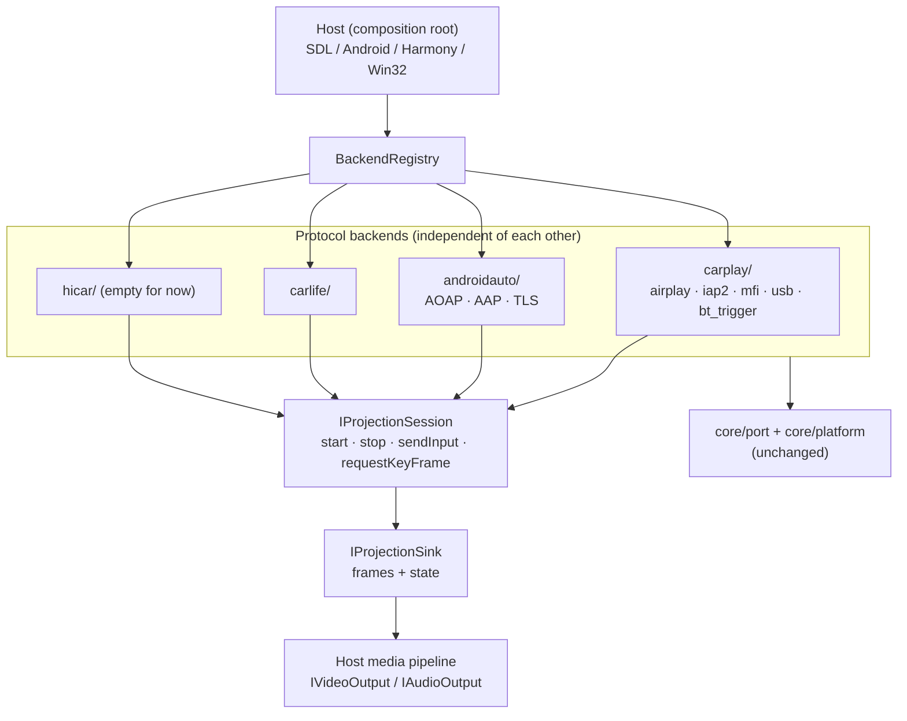

# Multi-Protocol Backends: Architecture Draft (CarPlay → +Android Auto / CarLife / HiCar)

<div align="left"><b>English</b> · <a href="projection-backend.zh-CN.md">简体中文</a></div>

> This document is a **plan**, not a completed implementation. See
> [`core/projection/backend.h`](../core/projection/backend.h) for the interface draft.
> Goal: turn the "protocol stack" into a replaceable backend so the host faces a single
> façade. The first backend is the existing CarPlay, with **zero behavior change**; then
> Android Auto, CarLife, and HiCar follow one by one.

## 1. Why touch this now

`core` is about 10k lines today, all serving CarPlay. The problem is not "the code looks
like CarPlay" — `core/port` and `IVideoOutput`/`IAudioOutput` are already
protocol-agnostic — the problem is the **boundaries**:

- `Receiver` in `core/airplay/server.cpp` is simultaneously the "protocol stack" and the
  "composition root": it starts RTSP, sends mDNS, owns `PlatformServices`, and manages
  sessions. A second protocol has nowhere to attach.
- Hosts (`host/wired_task.cpp`, `jni_bridge.cpp`, HarmonyOS `napi_bridge.cpp`) know
  `WiredControl` / `Receiver` / `bt_trigger` directly; protocol details leak into the
  composition root.
- Touch is an HID report inside `event_channel`; there is no protocol-neutral input
  semantics.

The later we split, the more CarPlay-specific code accumulates in `core` and the more
expensive the split becomes. Now is the cheapest window.

## 2. Target layering



Design rules:

1. **No protocol vocabulary in the interface.** No `pairVerify()`, `startSession()`,
   `AOAP`; only `start/stop/sendInput/onVideoFrame/onState`. Only capabilities needed
   across protocols go into the interface.
2. **The media plane does not move.** Decoding/rendering stays in the host
   (`IVideoOutput`/`IAudioOutput`); backends only deliver frames.
   All four use H.264 for video (HiCar may use HEVC) and AAC-family / Opus / LPCM for
   audio, so the existing enums suffice.
3. **The composition root does not change.** `PlatformServices` is still assembled by the
   host and injected into backends via `connect()`.
4. **Backends do not include each other.** The CarPlay backend imports nothing from AA.

## 3. Interface contract (summary)

The full definition is in `core/projection/backend.h`; only the **mandatory** parts are
recorded here.

### Lifecycle

```text
probe() → ProjectionTarget
connect(target, services, sink) → IProjectionSession
session.start()        // returns immediately; handshake happens on an internal thread
   → sink.onState(Connecting / Negotiating / Running)
session.stop()         // idempotent; no callbacks after it returns
```

- `start()` **does not block**. Wired CarPlay's iAP2 handshake and wireless CarPlay's BT
  trigger + RTSP negotiation are both slow; run them on internal threads and report
  progress through `onState`.
- A failed `connect()` returns `nullptr` and writes `err`; failures after `start()` go
  through `onState(Failed, detail)` — no exceptions.

### Threads

| Call / callback | Thread | Contract |
|---|---|---|
| `probe()` / `connect()` | caller | may be slow (ioreg / USB enumeration / mDNS) |
| `start()` / `stop()` | caller | `stop()` guarantees no callbacks after return |
| `sendInput()` / `requestKeyFrame()` | any | implementation locks internally |
| `onVideoConfig` / `onVideoFrame` | backend video thread | **may be concurrent** with audio and state |
| `onAudioConfig` / `onAudioFrame` | backend audio thread | same as above |
| `onState` | backend control thread | same as above |

This is precisely the generalization of the "asymmetry table" in section 5 of
`docs/architecture.md`: **the Sink implementation does its own locking; backends do not
care**.

### Input

`InputEvent` has only three kinds: Touch (normalized coordinates + contact id), Key
(semantic key value), Rotary (detent count). Each protocol translates its own:

| Protocol | Touch source | Keys / knob |
|---|---|---|
| CarPlay | HID reports from `event_channel` | media/voice keys in `session.cpp` |
| Android Auto | AAP input channel | AAP input channel |
| CarLife | proprietary protocol | proprietary protocol |
| HiCar | proprietary protocol | proprietary protocol |

`Capabilities` lets the UI know which controls to show before connecting.

## 4. Directory migration

### Target layout

```text
core/
├── projection/
│   ├── backend.h                 # interface (this draft)
│   ├── registry.cpp              # protocol registry
│   ├── carplay/
│   │   ├── backend_carplay.{h,cpp}   # adapter layer: wraps Receiver / WiredControl
│   │   ├── airplay/              # ← core/airplay moved wholesale
│   │   ├── iap2/                 # ← core/iap2 moved wholesale
│   │   ├── mfi/                  # ← core/mfi moved wholesale
│   │   ├── usb/                  # ← core/usb moved wholesale (including mux.h)
│   │   └── bt_trigger.*          # ← core/bt moved wholesale
│   ├── androidauto/              # Phase 3
│   ├── carlife/
│   └── hicar/
├── crypto/                       # unchanged: generic primitives (AA's TLS uses them too)
├── bplist/                       # unchanged: generic format
├── platform/                     # unchanged: device_identity / pairing_store
├── port/                         # unchanged
└── common/                       # unchanged
```

### Migration mapping

| Existing | Destination | Notes |
|---|---|---|
| `core/airplay/*` | `core/projection/carplay/airplay/` | RTSP, session, streams, event channel, control cipher |
| `core/iap2/*` | `core/projection/carplay/iap2/` | wired/wireless links |
| `core/mfi/*` | `core/projection/carplay/mfi/` | MFi identity |
| `core/usb/*` | `core/projection/carplay/usb/` | usbmux, wired_control, pair_record |
| `core/bt/bt_trigger.*` | `core/projection/carplay/` | the wireless trigger is iAP2-specific |
| `core/crypto/*`, `core/bplist/`, `core/platform/`, `core/port/`, `core/common/` | unchanged | generic |

**Include paths**: after the move, add the include directory `core/projection/carplay` to
`allplay_core`, so internal `#include "airplay/session.h"` and `"iap2/wire.h"` need no
changes and the move is a pure `git mv`.

## 5. Phased rollout

### Progress (2026-11-08)

- ✅ Interface + registry: `core/projection/backend.h`, `registry.cpp`.
- ✅ CarPlay backend: `core/projection/carplay/backend_carplay.{h,cpp}` wraps both
  wireless and wired sessions; `airplay / iap2 / mfi / usb / bt` were `git mv`'d wholesale
  into `core/projection/carplay/` (include paths remain compatible, zero protocol code
  changes).
- ✅ Wired Android Auto: `core/projection/androidauto/` covers AOAP → AAP VERSION →
  TLS 1.2 → service discovery → channels / audio-video / input;
  `platform/posix/aa_usb_libusb.cpp` provides the libusb port (shared by Linux + macOS).
  **Compiles; not yet verified on hardware.**
- 🟡 The host still uses the old `WiredTask` / `BtTask` / `Receiver` and has not switched
  to `BackendRegistry::connect()`; AA also has no UI entry point — that is the next step.
- 🟡 CarLife / HiCar: `core/projection/{carlife,hicar}/backend_*.cpp` are placeholder
  backends; `probe()` returns empty, `connect()` reports "not implemented", and the
  registry already accepts the interface.

### Phase 0 (done): interface only

- Add `core/projection/backend.h` and this document; do not wire CMake, do not change the
  host, do not touch existing code.
- Acceptance: `clang++ -fsyntax-only -Icore` passes; the existing build and real-device
  behavior are unchanged.

### Phase 1: CarPlay backend adapter (no directory move)

Add `core/projection/carplay/backend_carplay.{h,cpp}` wrapping the two existing flows:

- **Wired**: `probe()` uses `listUsbPhones` / ioreg to find an iPhone; `connect()` starts
  an internal thread running `openSystemUsbMuxd` / `openWiredCarPlay` + `WiredControl`,
  forwarding audio frames to `sink.onAudioFrame()`, video frames to
  `sink.onVideoFrame()`, and touch through `sendInput()`.
- **Wireless**: `probe()` returns paired Bluetooth phones; `connect()` starts `bt_trigger`
  + `Receiver`, and the adapter implements `Receiver`'s `IVideoOutput`/`IAudioOutput` as
  bridges that forward to `sink`.

Host changes:

- `host/wired_task.cpp` and the wireless path switch to
  `registry.find(Protocol::CarPlay)->connect(...)`; behavior, command line, and logging
  stay unchanged.
- Android / HarmonyOS hosts **stay untouched for now** (they still call core directly
  internally); unify them in Phase 2.

Acceptance (all must pass):

1. `allplay_host --wired` on hardware: video + audio + touch, same as today;
2. Wireless path: Bluetooth trigger → RTSP → keys/touch, same as today;
3. Disconnect/reconnect, `0x4301` resend, and audio byte swapping all pass regression;
4. Host code no longer includes `airplay/`, `iap2/`, or `usb/` headers directly.

### Phase 2: directory move + registry

- `git mv` per the table above, add the include directory; implement `BackendRegistry`;
  add `--protocol` to the host.
- Purely mechanical; recompile and rerun all Phase 1 regressions.

### Phase 3: wired Android Auto (second backend)

- New code in `core/projection/androidauto/`: AOAP (USB control requests 51/52/53) → AAP
  VERSION → TLS 1.2 (records wrapped in 0x0003) → service discovery → AAP protobuf
  channels (control / video / audio / input / sensor).
- Reference implementations: AASDK / OpenAuto.
- Acceptance: real Android phone, video + audio + touch.

> ⚠️ Platform prerequisite: wired CarPlay works on macOS because it "does not touch USB"
> and only borrows the system usbmuxd.
> **AA has no equivalent daemon** — AOAP must own the USB device itself. The current
> state is that both Linux and macOS use libusb (on macOS, user space can open non-Apple
> devices without DriverKit); on the same USB port CarPlay (NCM/usbmuxd) and AA (AOAP) are
> mutually exclusive, requiring "probe first, then claim, roll back on failure" port
> arbitration.

### Phase 4+: CarLife, HiCar

- CarLife: the protocol is not public; needs real-device packet capture, high uncertainty
  (estimated 4–8 weeks, may stall).
- HiCar: no Huawei documentation/partnership; reverse-engineering cost is unbounded. **Keep
  the interface, do not schedule.**

## 6. Open questions (decision points)

1. **USB port arbitration**: which one gets the cable first? Need probe order,
   re-enumeration, and failure-rollback strategy.
2. **Wireless connection management**: AA wireless / CarLife wireless both need a 5GHz AP,
   which is a separate system from CarPlay's hotspot logic (pushing SSID/password in
   0x4301); does the host need a unified connection manager?
3. **Multi-protocol UI**: one status bar, one window — how does the media pipeline reset
   when sessions switch?
4. **AA on macOS**: is it worth introducing DriverKit, or should AA only target
   Linux/Android hosts?
5. **Compliance**: MFi, AA, CarLife, and HiCar all lack formal authorization for
   third-party boxes; technically feasible ≠ commercially usable.
   This project already relies on a fake MFi identity, and adding protocols amplifies that
   risk.

## 7. What to do first

Do only Phase 0 + Phase 1 first:

- Do not move directories or change the CMake structure;
- Use the one CarPlay backend to test whether the interface holds up;
- Once wired AA works, decide whether to narrow the interface or add capabilities.

If Phase 1 finds that the interface needs a CarPlay-specific exception (for example, it
must expose details of `0x4301`), then the abstraction is wrong and should be fixed before
writing the second protocol.
